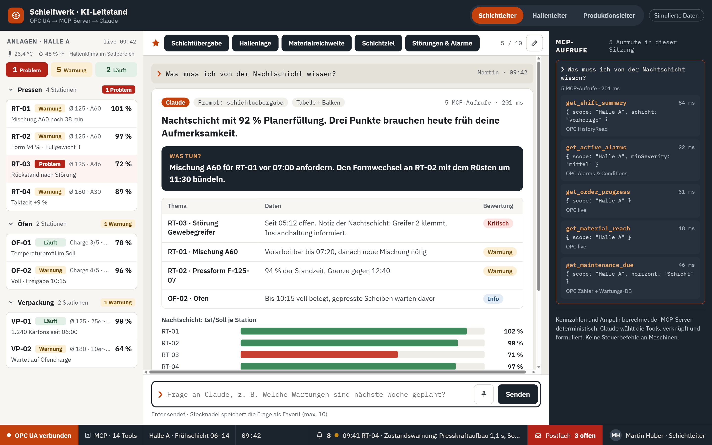

# Spezifikation OPCAgentSample

Stand 2026-10-16. Datenhaltung mit Redis als einzigem Speicher (Abschnitt 15, Auftrag T-006) umgesetzt; Entscheidungen 6, 9, 10 und 11 entsprechend angepasst.

---

## 1. Ziel

Ein Referenz-Sample, das zeigt, wie Maschinendaten über **OPC UA** und einen **MCP-Server** von einer KI (Claude) in natürlicher Sprache abgefragt werden – mit einer **Live-Demo als Weboberfläche** (PC und Handy).

Szenario: simulierte Produktionshalle für **Schleifmittel** (Trennscheiben für Handflexmaschinen). Drei Rollen fragen dieselben Daten in unterschiedlicher Verdichtung ab.

Kernaussage der Demo: **Ein Dashboard zeigt, *dass* etwas ist. Die KI erklärt, *warum* und *was zu tun ist* – auf Basis derselben verlässlichen Daten.**

Abgrenzung:
- **Nur lesend.** Keine Steuerbefehle an Maschinen (kein Start/Stop, keine Sollwerte). Diese Grenze in der Demo sichtbar machen.
- **Kennzahlen und Ampeln berechnet der MCP-Server deterministisch**, nie die KI. Claude wählt Tools, verknüpft Ergebnisse und formuliert.
- Fokus des Repos: OPC-UA-Schnittstelle und MCP-Beispiele. Wartungs-DB, Aufträge, Stammdaten sind **vorausgesetzt und mit Testdaten befüllt** (keine Pflege-Oberflächen).

Vorbilder (eigene Repos):
- `vompa/ODataAgentSample` – Muster für Live-Demo (Container App, Chat mit Claude über eigenen MCP, nur lesend, Zugangscode + Kontingent, Deploy per GitHub Actions, Bicep).
- `vompa/OPCSample` – vorhandener OPC-UA-Client mit Rx.NET und MCP-Zugang; prüfen, was wiederverwendet werden kann.

---

## 2. Szenario

### Werk und Halle
- Werk mit Hallen A, B, C. **Ausmodelliert ist nur Halle A**; B und C liefern nur Zähler/Zustände für den Werksvergleich.
- Halle A, Materialfluss in drei Stufen:

| Stufe | Stationen | Typ |
|---|---|---|
| 1 · Pressen | RT-01, RT-02, RT-03, RT-04 | Rundtisch-Pressen für Trennscheiben |
| Puffer | PU-OFEN | Ofenplatten zwischen Pressen und Öfen |
| 2 · Aushärten | OF-01, OF-02 | Aushärteöfen |
| 3 · Verpackung | VP-01, VP-02 | Verpackstellen mit Umreifer |

- Rundtisch-Teilstationen: Gewebezuführung 1 (Greifer 1/2), Dosierung mit Waage, Abstreifer, Gewebezuführung 2 + Etikett, Presse, Ausstoß.
- Artikel: Durchmesser Ø 115/125/180/230 mm, Körnungen A30/A36/A46/A60, Dicken 1,0–3,0 mm.

### Betrieb
- **3-Schicht-Betrieb**: Früh 06–14, Spät 14–22, Nacht 22–06; Produktion Mo 06:00 bis Sa 06:00, Wochenende frei.
- **Simulationsuhr**: Demo steht auf **Do 15.10.2026, 09:42 (KW 42)**. Uhr setzbar und beschleunigbar (z. B. um die Drift an RT-04 live wachsen zu lassen).
- Zeitstempel intern in UTC speichern (Zeitumstellung 25.10.2026 liegt im Zukunftsfenster).

### Rollen (Benutzer der Demo, fiktiv)
| Rolle | Benutzer | Sicht | Geräte | Rechte |
|---|---|---|---|---|
| Schichtleiter | Martin Huber | Halle A (8 Stationen) | Hallenbüro-PC und Handy | Lesen, Notizen, Stillstandsgründe |
| Hallenleiterin | Katharina Gruber | Halle A inkl. Wartungsplanung | PC, Handy | Lesen, Notizen, Wartungsfreigabe |
| Produktionsleiter | Stefan Wallner | Werk (Hallen A–C) | PC, Handy | Lesen, Freigaben |

Die Rolle bestimmt, welche Daten der MCP-Server liefert. **Keine personenbezogene Leistungsauswertung** (in AT mitbestimmungspflichtig): Besetzung nur auf Team-/Schicht-Ebene, keine Namen an Maschinendaten.

---

## 3. Architektur

```
OPC-UA-Server (Simulator, Halle A)
   │  Subscriptions, Read, HistoryRead, Alarms & Conditions
   ▼
MCP-Server (OPC-UA-Client + Wartungs-DB + Stammdaten + Aggregation)
   │  Tools, Resources, Prompts · Rollen-Scoping · deterministische KPIs/Ampeln
   ▼
Claude (über API, Modell wie ODataAgentSample)
   ▲
   │  Backend-API (Zugangscode, Kontingent, Protokoll der Tool-Aufrufe)
Web-Frontend (Desktop + Mobil)
```

- Echtzeit und Aggregat trennen: Der OPC-Server liefert Rohwerte/Zustände, der MCP-Server verdichtet (Schicht, Tag, OEE, Pareto, Kosten).
- Tool-Aufrufe werden protokolliert (Nachvollziehbarkeit) und im Frontend im MCP-Band angezeigt.
- Qualitätsstandard laut `working-style.md` (Microsoft-Konventionen, `.editorconfig`, Nullable, Warnungen als Fehler, Tests).

---

## 4. OPC-UA-Informationsmodell

### Hierarchie
```
Objects/
└─ Werk/
   ├─ HalleA/
   │  ├─ Klima          (Temperatur, rel. Luftfeuchte)
   │  ├─ Pressen/       RT-01 … RT-04   (RundtischType)
   │  ├─ Puffer/        PU-OFEN         (PufferType)
   │  ├─ Oefen/         OF-01, OF-02    (OfenType)
   │  └─ Verpackung/    VP-01, VP-02    (VerpackungType)
   ├─ HalleB/, HalleC/  (nur Zähler/Zustände)
   └─ Schichtkalender   (aktuelle Schicht, Beginn, Ende)
```
Orientierung an der Companion Spec **OPC 40001-1 Machinery** (Identification, MachineryItemState, Betriebszähler/Lebensdauer-Variablen) prüfen.

### StationType (Basis aller Stationen)
| Gruppe | Knoten |
|---|---|
| Identität | StationId, Bezeichnung, Bereich, Hersteller, Baujahr |
| Zustand | Betriebszustand (Enum: Läuft, Leerlauf, Rüsten, Störung, WartungGeplant, WartetMaterial, WartetVorstufe, LäuftOhneAuftrag), ZustandSeit |
| Auftrag | AuftragsNr, ArtikelNr, SollMenge, IstMenge, SollTakt, Ereignis „Auftragsmenge erreicht" |
| Zähler | StückGut, StückAusschuss je Grund, Betriebsstunden, Zyklen gesamt |
| Alarme | Alarms & Conditions (Severity, Quittierung, Station/Baugruppe) |
| Energie | kWh seit Schichtbeginn |

`WartetMaterial` / `WartetVorstufe` trennen eigene Probleme von Folgeproblemen (Kern der VP-02-Geschichte).

### RundtischType
| Gruppe | Knoten (Einheit) |
|---|---|
| Prozess | TaktzeitIst/Soll (s), Presskraft (kN), PresskraftAufbauzeit (s), Presszeit (s), Formtemperatur (°C), Füllgewicht letzter Wert + gleitender Mittelwert + Soll + Toleranz (g), Dicke (mm) |
| Teilstationen | je Zustand und Störzähler (Greifer 1/2 getrennt) |
| Material | Mischung (Rezept), ChargenId, Füllstand (kg), VerarbeitbarBis (DateTime), Gewebemagazin, Etikettenmagazin (Stück) |
| Werkzeug | FormId, HübeSeitWechsel, Standzeitgrenze |
| Hydraulik | Öltemperatur (°C), Systemdruck (bar) |
| Ausschussgründe | Gewicht, Dicke, Gewebe, Etikett, Bruch |

### OfenType
| Gruppe | Knoten |
|---|---|
| Kapazität | Chargenplätze (5), BelegtePlätze, Belegung (%) |
| Laufende Charge | ChargenId, Durchmesser, Ofenplatten, Profilschritt (Aufheizen/Halten/Abkühlen), Restzeit (min) |
| Temperatur | Zone 1–3 Ist/Soll (°C) |
| Planung | NächsteFreigabe, **Zuordnungsregel** (welche Durchmesser) |
| Sicherheit | Türverriegelung Zustand, LetztePrüfung |

Die Zuordnungsregel als lesbarer Knoten belegt: Engpass OF-02 ist eine Planungsregel, keine technische Grenze.

### PufferType
AnzahlPlatten, Kapazität, ÄltesteWartezeit, MittlereWartezeit (min), Platten je Durchmesser.

### VerpackungType
Kartontyp, StückJeKarton, KartonsIst/Soll, Kontrollwaage-Fehlmengen, Kartonmagazin, Etiketten, Umreifer-Zustand.

### Klima (Halle A)
Temperatur (°C), relative Luftfeuchte (% rF); Sollbereich für Mischungen 18–26 °C, 40–60 % rF (Stammdatum).

### Kennzahlen (im MCP-Server berechnet, nicht im OPC-Server)
- Ist/Soll je Station/Bereich/Halle inkl. Hochrechnung bis Schichtende
- OEE (Verfügbarkeit × Leistung × Qualität) je Station, Bereich, Schicht, Halle, Werk
- Ofenbelegung, Pufferwartezeit
- Stillstand nach Grund (Pareto), MTBF/MTTR je Station und Baugruppe
- Kosten = Stillstand × Kostensatz + Ausschuss × Stückkosten (Kostensätze simuliert)
- **Ampel** je Station aus Grenzwerten, schlechtester Wert bestimmt: **Läuft · Warnung · Problem**
- Regel **Überproduktion**: Ist/Soll > 105 % ohne laufenden Auftrag → Warnung, auch wenn die OEE gut aussieht

---

## 5. Datenhorizont

| Bereich | Von | Bis | Quelle |
|---|---|---|---|
| Maschinendaten (Rohdaten) | **Mo 05.10.2026 00:00** (Beginn KW 41) | jetzt | OPC HistoryRead |
| Wartung, Prüfungen, Schichtkalender, Feiertage | jetzt | **So 17.01.2027** (Ende KW 2) | Wartungs-DB / Stammdaten |
| Wartungshistorie (erledigte Aufträge, letzte Kalibrierung) | rückwirkend | – | Wartungs-DB (klein, bleibt) |
| Aufträge | jetzt | ca. 3 Wochen (bis KW 45) | Auftragsdaten; danach grober Absatzplan je Artikelgruppe und Woche |

**Entschieden: Historie B** (Abschnitt 13): zusätzlich Tageskennzahlen je Station ein Quartal zurück.

### Auflösung der Historie
| Datenart | Auflösung |
|---|---|
| Zykluswerte Rundtische (Füllgewicht, Presskraft, Presskraftaufbau, Taktzeit, Dicke) | je Takt (ca. 4,2 s) |
| Zähler, Ofenwerte, Puffer, Verpackung, Klima | 1 min |
| Zustände, Alarme, Auftragsereignisse | ereignisbasiert |

Größenordnung: ca. 5 Mio. Zykluswerte + einige 100.000 Minutenwerte. Der Simulator erzeugt die Historie **vorab mit festem Seed** (reproduzierbar) und liefert sie per HistoryRead aus.

---

## 6. Ereignisse der Historie

### Kategorien
| Kategorie | geplant? | OEE-Wirkung |
|---|---|---|
| Störung (> 5 min) | nein | Verfügbarkeit |
| Kurzstopp (< 5 min) | nein | Leistung |
| Taktverlust | nein | Leistung |
| Warten auf Material (Mischung, Gewebe, Kartons) | nein | Verfügbarkeit |
| Warten auf Vorstufe | nein | Verfügbarkeit |
| Qualitätssperre / Ausschuss | nein | Qualität |
| Personal fehlt | organisatorisch | Verfügbarkeit |
| Rüsten, Wartung geplant | ja | getrennt ausgewiesen |
| **Überproduktion** (über Auftrag / vor Bedarf) | nein | keine → eigene Kennzahl |

Ereignis-Datensatz: Start, Ende, Station, Baugruppe, Kategorie, Ursache, betroffene Stück, quittiert, Notiz.

### Drehbuch (feste Ereignisse; Summen müssen exakt zu den Referenzantworten passen)
| Wann | Station | Kategorie | Ereignis | Folge |
|---|---|---|---|---|
| Mo 05.10. Früh | RT-03 | Störung | Greifer 2 klemmt, 38 min | erster Hinweis auf Muster |
| Di 06.10. Spät | RT-01 | **Überproduktion** | Auftrag 4688 (Ø 125 A60) 19:10 erreicht, Folgeauftrag nicht freigegeben, läuft bis 22:00: +2.050 Stück | Lager über Bedarf, 2 Ofenchargen zusätzlich |
| Mi 07.10. Nacht | RT-02 | Warten auf Material | Mischung A60 zu spät, 52 min | Nachtschicht-Muster |
| Do 08.10. Früh | RT-04 | Qualitätssperre | Dickenabweichung nach Formwechsel, 12 min, 340 Stück Ausschuss | „Rüsten über Soll" |
| Do 08.10. Spät | RT-03 | Störung | Greifer 2, 47 min | |
| Fr 09.10. Nacht | RT-04 | Personal fehlt | ganze Schicht nicht besetzt | organisatorisch |
| Mo 12.10. Früh | OF-01 | Störung | Temperaturabweichung Zone 2, Charge +25 min | Ofenbelegung verschiebt sich |
| Mo 12.10. Nacht | RT-02 | **Überproduktion** | Auftrag 4705 (Ø 125 A60) 2 Tage vor Bedarf: +3.600 Stück | Puffer erreicht 58 Platten |
| Di 13.10. Früh | RT-04, VP-02 | Warten auf Vorstufe | Ø-180-Platten 70 min vor OF-02, VP-02 steht 45 min | Ursprung „Warten auf Ofen" |
| Di 13.10. Spät | VP-02 | Störung | Umreifer, 18 min | |
| Di/Mi Nacht | RT-01, RT-02 | Warten auf Material | Mischung zu spät, Mi-Nacht zusammen 2,3 h | Nacht-OEE 72 % |
| Mi 14.10. Spät | RT-03 | Störung | Greifer 2, 3 × | 9 von 14 Störungen Gewebezuführung KW 42 an RT-03 |
| Mi 14.10. 22:00 | RT-01, RT-02 | Qualitätsdrift | Charge M-2410-17: Füllgewicht +1,5 g | Ausschuss ca. 3 % |
| Do 15.10. 05:12–07:05 | RT-03 | Störung | Greifer 2 klemmt | Rückstand 1.200 Stück |
| Do 15.10. ab 08:30 | RT-04 | Taktverlust | Presskraftaufbau 0,8 → 1,1 s linear | Taktzeit +9 % |
| Do 15.10. 08:14 / 08:51 | RT-02 / VP-01 | Kurzstopp | Etikettenzufuhr leer 2 min / Kartonstau 1 min | |
| Do 15.10. ab 09:05 | VP-02 | Warten auf Vorstufe | wartet auf Ø-180-Charge aus OF-02 | |

Ursachenkette Überproduktion (Demo-Höhepunkt): **RT-02 produziert vor Bedarf (Mo 118 % Ist/Soll, im Dashboard grün) → Puffer vor den Öfen voll → Ø-180-Platten von RT-04 warten → VP-02 steht.**

Summen KW 42 Halle A (müssen getroffen werden): Gewebezuführung 6,4 h / 14 Ereignisse (9 an RT-03); Warten auf Mischung 4,1 h; Warten auf Ofen 3,5 h; Rüsten über Soll 3,2 h; Formwechsel ungeplant 2,0 h (3 Ereignisse); Etiketten leer 1,1 h. Gestern (Mi): OEE Früh 82 %, Spät 80 %, Nacht 72 %.

### Grundrauschen (fester Seed)
Ca. 2 Kurzstopps je Station und Schicht, Taktzeit ±2 %, Füllgewicht σ 0,5 g, Grundausschuss ca. 0,8 %, Klima mit Tag-Nacht-Verlauf (heute 06:00 → 09:42: +1,2 °C).

### Erweiterungen 3-Schicht-Betrieb (1–4 entschieden, Abschnitt 13)
1. **Rückverfolgung** Mischungscharge → Rundtisch/Schicht → Ofencharge → Karton/Palette (inkl. Rotations-/Bruchprüfung je Charge). Frage: „Welche Kartons enthalten Scheiben aus Charge M-2410-17, und sind sie ausgeliefert?"
2. **Anlaufverluste** 15–20 min nach jedem Schichtwechsel.
3. **Hallenklima als Gegenhypothese** zur Füllgewichtsdrift (Claude prüft und schließt aus).
4. **Reaktionszeit Instandhaltung nachts** (Bereitschaft) erklärt längere MTTR und Nacht-OEE.
Weitere: Übergabenotizen als Freitext je Schicht/Station, Pausenmuster, Montag-Anfahren (Ofen aufheizen, erhöhter Ausschuss), Freitag-Auslauf (verfallene Mischung), Stillstände ohne Grund („Sonstiges", nachts gehäuft) für Datenqualitäts-Fragen.

---

## 7. Startzustand (Do 15.10.2026, 09:42)

| Station | Kennzahl | Ampel | Notiz | Detail |
|---|---|---|---|---|
| RT-01 | 101 % Ist/Soll | Warnung | Mischung A60 noch 38 min | Ø 125 · A60; Füllgewicht Ø 113,4 g (Soll 112 ± 1,5); verarbeitbar bis 10:20 |
| RT-02 | 97 % | Warnung | Form 94 % · Füllgewicht ↑ | Ø 125 · A60; Ø 113,6 g; Form F-125-07 Grenze ca. 12:40; Rüsten 11:30 auf Ø 115; Gewebe 55 min |
| RT-03 | 72 % | Problem | Rückstand nach Störung | Ø 125 · A46; Auftrag 4711; Rückstand ca. 1.200 Stück |
| RT-04 | 89 % | Warnung | Taktzeit +9 % | Ø 180 · A30; Takt 4,6 s (Soll 4,2); Presskraftaufbau 1,1 s (Soll 0,8); 2.760 statt 3.100 Stück seit 06:00 |
| OF-01 | 78 % Belegung | Läuft | Temperaturprofil im Soll | Charge 3/5 · 180 °C; freie Etage ab 09:50; Prüfung Türverriegelung seit 2 Tagen überfällig (DB) |
| OF-02 | 96 % Belegung | Warnung | Voll · Freigabe 10:15 | Charge 4/5 · 180 °C; Zuordnungsregel: alle Ø 180 |
| PU-OFEN | 42 Platten | – | Ø 45 min Wartezeit | |
| VP-01 | 98 % | Läuft | 1.240 Kartons seit 06:00 | Ø 125 · 25er-Karton; Kartons reichen 1 h 40 min |
| VP-02 | 64 % | Warnung | Wartet auf Ofencharge | Ø 180 · 10er-Karton; WartetVorstufe seit 09:05 |
| Klima | 23,4 °C · 48 % rF | im Sollbereich | | |

Pressen gesamt bis jetzt: Ist 11.150 / Soll 12.400; Hochrechnung 14:00: 24.100 von 26.800 (90 %).

---

## 8. Stammdaten und Seed

| Bereich | Inhalt |
|---|---|
| Artikel | Ø 115/125/180/230, Körnungen, Dicke |
| Mischungen/Chargen | u. a. M-2410-17 (A60) mit Schüttdichte |
| Aufträge | 4688, 4698 (RT-02, fertig 11:20), 4702 (abgeschlossen 08:55, 8.400 Stück), 4705, 4711 (Ø 125 A46, 76 %), 4730 (Ø 230 A36, 58 %, Termin Di), 4733 (Ø 230 A30, 41 %, Termin Di) |
| Formen | F-125-07 (RT-02), F-180-03 (RT-04, 4.100 Hübe/Tag) |
| Kostensätze | € je Stillstandsminute je Station, € je Ausschussstück je Artikel (simuliert) |
| Benutzer/Rollen | siehe 2. |
| Eskalationsregeln (Postfach) | z. B. „sicherheitsrelevant und > 24 h überfällig → Produktionsleiter" |
| Favoriten | 5 Standard je Rolle, max. 10 je Benutzer (serverseitig, gelten PC und Handy) |

### Wartungs-DB: Pläne und Termine (bis 17.01.2027)
| Wann | Station | Wartung | Art |
|---|---|---|---|
| heute | OF-01 | Türverriegelung, **seit 2 Tagen überfällig** | Sicherheitsprüfung |
| heute 11:30 | RT-02 | Form F-125-07 (W-3381), bündelbar mit Rüsten | Hubzähler |
| heute | RT-04 | Hydraulik-Sichtprüfung empfohlen (Drift) | zustandsbasiert |
| morgen | RT-01 | Waage kalibrieren, bündelbar mit Mischungswechsel | Prüfmittel |
| morgen 14:00 | VP-01 | Umreifer | planmäßig |
| Mo 19.10. | RT-02 | Hydrauliköl wechseln, 45 min | zeitbasiert |
| Di 20.10. | OF-02 | Temperaturfühler Zone 1–3 kalibrieren, 60 min | Prüfmittel |
| ca. Mi 21.10. | RT-04 | Form F-180-03, bündelbar mit Rüsten 13:00 | Prognose aus Hüben |
| ca. Do 22.10. | VP-02 | Umreifer Verschleißteile, 30 min | Prognose aus Betriebsstunden |
| KW 45 | RT-04 | Hydraulikwartung (regulär; Empfehlung: vorziehen) | zeitbasiert |
| Dezember | Pressen | jährliche Sicherheitsprüfungen | Prüfung |
| **Do 24.12.2026–Mi 06.01.2027** | alle | **Betriebsurlaub = Wartungsfenster**: Ofenrevision OF-01/02, Generalinspektion Rundtische | geplant |
| Jänner | RT-01…04 | Waagen kalibrieren (quartalsweise) | Prüfmittel |

Wartungshistorie u. a.: Waagen RT-01/RT-02 im Juli kalibriert, unauffällig.

### Kalender
Feiertage AT im Fenster: Mo 26.10. (Nationalfeiertag), So 01.11., Di 08.12., Fr 25.12., Sa 26.12., Fr 01.01., Mi 06.01. Neustart nach Betriebsurlaub Do 07.01.2027. Optionale Zusatzschicht Samstag (Halle B, für Ø-230-Aufträge).

---

## 9. MCP-Schnittstelle

### Tools (semantisch, Ergebnisse mit Einheit, Soll, Toleranz, Bewertung, Kontext, Zeitstempel)
| Tool | Parameter | Liefert |
|---|---|---|
| `get_hall_overview` | hallId, stationType? | alle Stationen: Zustand, Dauer, Auftrag, Kennzahl, Ampel |
| `get_machine_status` | machineId | Zustand, Auftrag, Prozesswerte mit Bewertung, Material, Alarme |
| `get_active_alarms` | scope, minSeverity, zeitraum?, inklusiveQuittiert? | Alarme mit Dauer/Quittierung |
| `get_material_reach` | scope | Reichweiten inkl. Verarbeitbarkeit der Mischung |
| `get_order_progress` | machineId \| orderId \| scope, filter?, stufe? | Fortschritt, Restlaufzeit, Charge, Folgeauftrag |
| `get_process_trend` | machineId(s), variable, zeitraum | verdichteter Verlauf + Drift-Bewertung |
| `get_shift_summary` | scope, schicht | Stück, Ausschuss nach Grund, Stillstände, OEE |
| `get_oee` | scope, zeitraum, gruppierung | OEE mit V/L/Q |
| `get_downtime_pareto` | scope, zeitraum, gruppierung?, filter?, bewertung? | Stillstand nach Grund (Dauer, Häufigkeit, Kosten) |
| `compare` | dimension, kpi, zeitraum | Vergleichstabelle |
| `get_maintenance_due` | scope, horizont \| von/bis, prognose?, baugruppe?, historie?, filter? | Wartungen fällig/geplant/prognostiziert/überfällig |
| `get_condition_warnings` | scope | zustandsbasierte Auffälligkeiten |
| `check_maintenance_conflicts` | hallId, zeitraum | Kollisionen mit Aufträgen, Bündelungsvorschläge |
| `get_reliability_kpis` | scope, zeitraum, gruppierung? | MTBF, MTTR, Anteil geplant/ungeplant |
| `get_action_items` | role, hallId? | Postfach-Einträge aus Eskalationsregeln (deterministisch) |

Optional: `browse_node` / `read_node` als Expertenmodus.
Spätere Erweiterungen je nach Entscheidung: Rückverfolgung (`trace_batch`), Überproduktion (`get_overproduction`).

### Resources
`plant://structure`, `plant://shift-calendar`, `plant://kpi-definitions`, `plant://machine/{id}/addressspace`.

### Prompts
`schichtuebergabe`, `tagesbesprechung_halle`, `wochenreport` (weitere je Favorit möglich).

### Rollen-Scoping
Der MCP-Server filtert nach Rolle (Schichtleiter: Halle A; Produktionsleiter: Werk). Claude sieht nur, was die Person sehen darf. Meldungsfilter: Schichtleiter alle, Hallenleiter ab Warnung, Produktionsleiter nur Eskalationen.

---

## 10. Favoriten und Referenzfragen

### Standard-Favoriten (Übersichten, nicht maschinenspezifisch; Kurztitel als Schaltfläche)
| Rolle | Kurztitel → Frage |
|---|---|
| Schichtleiter | **Schichtübergabe** → Was muss ich von der Nachtschicht wissen? · **Hallenlage** → Wie ist die Lage in der Halle gerade? · **Materialreichweite** → Wie lange reicht das Material an allen Stationen? · **Schichtziel** → Schaffen wir das Schichtziel? · **Störungen & Alarme** → Welche Störungen und Alarme gab es in dieser Schicht? |
| Hallenleiterin | **Tagesbesprechung** → Bereite die Tagesbesprechung vor. · **Hallen-OEE heute** → Wie läuft die Halle heute? · **Zeitverluste** → Wo verlieren wir diese Woche am meisten Zeit? · **Qualitätslage** → Wie ist die Qualitätslage in der Halle? · **Wartungsplan** → Welche Wartungen stehen heute und morgen an? |
| Produktionsleiter | **Wochenbericht** → Fass mir die Woche zusammen. · **OEE-Vergleich** → Welche Schicht hat diese Woche die schlechteste OEE und warum? · **Gefährdete Aufträge** → Welche Aufträge sind diese Woche gefährdet? · **Instandhaltung** → Wie entwickelt sich der Anteil ungeplanter Stillstände? · **Kosten der Woche** → Was haben uns Ausschuss und Stillstände diese Woche gekostet? |

### Detailfragen (über Postfach „Mit Claude analysieren" oder freie Eingabe)
Warum hängt RT-04 hinterher? · Warum steht VP-02? · Sind die Öfen heute der Engpass? · Können wir die Formwartung an RT-02 mit dem Rüsten bündeln? · Lohnt sich eine Überholung von RT-03? · Welche Wartungen sind in der nächsten KW geplant? / Welche Maschinen haben nächste Woche eine Wartung? · (neu, falls Historie-Erweiterungen kommen) Wo haben wir über Bedarf produziert? · Welche Kartons enthalten Charge M-2410-17? · Was machen wir im Weihnachtsstillstand?

### Referenzantworten (Kernaussagen = Testfälle für den MCP-Server)
Die vollständigen Antworten (Tabelle, Diagramm, Warum, Was tun, Tool-Aufrufe) stehen im Mockup (`mockup/Main.dc.html`, Objekt `A` im Script-Block). Kurzfassung:

| Frage | Kernaussage | Tools |
|---|---|---|
| Schichtübergabe | Nacht 92 % Planerfüllung; RT-03 Störung offen, Mischung RT-01 bis 07:20, Form RT-02 94 %, OF-02 bis 10:15 voll | shift_summary, active_alarms, order_progress, material_reach, maintenance_due |
| Hallenlage | 5 von 8 Stationen brauchen Aufmerksamkeit, kritisch nur RT-03; RT-04→OF-02→VP-02 hängt zusammen | hall_overview, active_alarms, action_items |
| Materialreichweite | RT-01 zuerst: Mischung A60 in 38 min nicht mehr verarbeitbar (Füllstand reicht 70 min) | material_reach, order_progress |
| Schichtziel | Pressen hochgerechnet 90 %; Lücke RT-03 (1.200) und RT-04 (400); Option 4711 teilweise auf RT-01 ab 11:30 | hall_overview, shift_summary, order_progress |
| Störungen & Alarme | 4 Ereignisse, 68 min Stillstand, eine Warnung offen (RT-04) | active_alarms, downtime_pareto |
| Tagesbesprechung | gestern 78 % OEE, Nacht 72 % wegen Mischung (2,3 h) | shift_summary, downtime_pareto, maintenance_conflicts, material_reach |
| Hallen-OEE heute | 81 % OEE; Pressen 79, Öfen 87 Belegung, Verpackung 84 | oee, hall_overview, compare |
| Zeitverluste | Gewebezuführung 6,4 h (9/14 an RT-03, Greifer 2) | downtime_pareto, compare |
| Qualitätslage | RT-01 und RT-02 driften, gemeinsamer Faktor Charge M-2410-17; Waagen unauffällig | compare, process_trend, order_progress, maintenance_due |
| Wartungsplan | 5 Wartungen in 48 h, OF-01 überfällig; Bündeln senkt Stillstand 95 → 40 min | maintenance_due, maintenance_conflicts, condition_warnings |
| Wochenbericht | KW 42: 96 % Plan, OEE 79 % (Vorwoche 78), 2 Ø-230-Aufträge gefährdet | oee, compare, order_progress, reliability_kpis |
| OEE-Vergleich | Nacht 73 %, Ursache Verfügbarkeit (Mischung 5,8 h werksweit) | oee, downtime_pareto |
| Gefährdete Aufträge | 4730 und 4733 (Ø 230) kritisch, 4711 aufholbar | order_progress, oee, compare |
| Instandhaltung | Anteil ungeplant sinkt; 1 Sicherheitsprüfung überfällig (OF-01) (Historie B) | reliability_kpis, maintenance_due |
| Kosten der Woche | ca. 41.000 € (Ausschuss 14.500, Stillstand 26.500), größter Posten RT-03 9.800 € | downtime_pareto, compare, reliability_kpis |
| Warum steht VP-02? | kein eigenes Problem, wartet auf Ø-180-Charge aus OF-02 | machine_status, hall_overview, order_progress |
| Öfen Engpass? | OF-02 96 %, OF-01 78 % — Zuordnungsregel, keine technische Grenze | hall_overview, process_trend, order_progress |
| Wartungen nächste KW | KW 43: 4 geplant + Empfehlung Hydraulik RT-04 vorziehen | maintenance_due (von/bis, prognose), condition_warnings, maintenance_conflicts |

---

## 11. Weboberfläche

### Desktop (Hallenbüro, PC) – 1440 × 900 muss ohne Scrollen links alles zeigen
- **Kopf**: Logo, „Schleifwerk · KI-Leitstand", Untertitel „OPC UA → MCP-Server → Claude", Rollenumschalter (Schichtleiter / Hallenleiter / Produktionsleiter), Hinweis „Simulierte Daten".
- **Links (ca. 290 px): Anlagen · Halle A**
  - Zeile darunter, kleiner als Überschrift, nur Text mit Icons: Thermometer 23,4 °C · Tropfen 48 % rF · „Hallenklima im Sollbereich" (Tooltip: Sollbereich, Trend seit Schichtbeginn).
  - Drei Zähler: Problem / Warnung / Läuft.
  - Einklappbare Kategorien **Pressen / Öfen / Verpackung** (Anzahl Stationen, Schild mit schlechtestem Status, z. B. „1 Problem").
  - Je Station zwei Zeilen: oben Kennung, Statuswort (feste Breite), Artikel/Charge, rechts Kennzahl (Einheit als Tooltip); unten die Meldung in voller Breite. Station mit „Problem" hellrot hinterlegt.
- **Mitte: Prompt-Verlauf wie Claude Code**
  - Oben schmales Band: **nur Stern** + Favoriten als Schaltflächen mit Kurztitel (Tooltip: volle Frage), rechts „5 / 10" und Stift (Bearbeiten: × je Favorit, Felder Kurztitel ≤ 22 Zeichen + Frage, Standard-Favoriten zurückholen; max. 10).
  - Verlauf: `❯ Frage`-Zeile (Mono), darunter Antwortkarte; neue Antworten unten, Auto-Scroll.
  - Eingabe unten mit `❯`, Enter sendet, Stecknadel speichert die Frage als Favorit.
- **Rechts (ca. 330 px, dunkel): MCP-Aufrufe** – je Frage ein Block mit Tool, Parametern, Laufzeit, Datenquelle; neuester hervorgehoben; Gesamtzahl der Sitzung; per Einstellung ausblendbar (Endanwender-Präsentation).
- **Unten Statusleiste wie VS Code**: OPC-UA-Verbindung (Akzentfarbe), „MCP · n Tools", Bereich/Schicht, Uhrzeit · rechts Meldungen (Anzahl + neueste), **Postfach** (rot bei dringenden offenen Fällen), Benutzer. Klick öffnet jeweils ein Fenster darüber:
  - Postfach: Fälle mit Dringlichkeit, Frist, Lage; „Mit Claude analysieren" (Frage in den Verlauf), „Übernehmen" (Name + Uhrzeit).
  - Meldungen: Ereignisstrom, nach Rolle gefiltert.
  - Benutzer: Name, Funktion, Sicht, Arbeitszeit, Rechte, Benachrichtigung; Hinweis zum Rollen-Scoping.

### Mobil (alle Rollen; 390 × 844)
- Kopf wie in der Claude-App: links ☰ (öffnet die Seitenleiste), in der Mitte die Rollenauswahl als Menü („Schicht ▾“, Häkchen an der aktiven Rolle), rechts Stift = neue Sitzung. OPC-Status und Uhrzeit stehen in der Seitenleiste und auf der Übersicht, eine Verbindungsstörung als Hinweis unter dem Kopf.
- Seitenleiste von links: Sitzungen nach Tag (Heute, Gestern, Datum) mit erster Frage, Uhrzeit und Anzahl, „aktuell“ markiert; unten Benutzer mit Rolle, Reports und Abmelden. Schließen per Tippen daneben, Esc oder Wischen nach links.
- Untere Navigation: **Übersicht · Fragen · Postfach · Meldungen · Reports** (Badges).
- Übersicht: Begrüßung, Hallenklima-Textzeile, Zähler Problem/Warnung/Läuft, „Jetzt zu tun" (2 dringendste Fälle), Stationsliste nach Pressen/Öfen/Verpackung (Produktionsleiter: Hallen).
- Fragen: ganzer Verlauf auf der Fläche (Frage als Sprechblase rechts, Antwortkarte darunter, läuft beim Einlaufen mit); leere Sitzung mit Begrüßung und den Favoriten als Vorschlagskarten; sonst die Favoriten als aufklappbare Leiste „Favoriten 5“ über der Eingabe (zweispaltig, Zustand wird gemerkt); Eingabe als abgerundetes Feld mit Mikrofon bzw. Senden; Tool-Aufrufe eingeklappt.
- Favoriten werden am PC bearbeitet und gelten auf beiden Geräten.

### Maschinen-Report (Reports, Reiter „Maschinen“; Entscheidung 12)
- **Zeitraum**: laufende Schicht, gestern, diese Woche, letzte 4 Wochen (KW-Spanne), optional **Vergleich mit der Vorperiode** (vorherige Schicht, Vortag, Vorwoche, vorherige 4 Wochen; verglichen werden Quoten, weil die laufende Periode offen ist). Start je Rolle: Schichtleiter Schicht, Hallenleiterin Woche, Produktionsleiter 4 Wochen mit Kosten (Kosten in € für alle per Schalter).
- **Raster der 8 Stationen** (Halle A): OEE mit Bewertung in Form und Wort (Öfen: Belegung), Ist/Soll, Ausschussquote, Stillstand, Pfeil zur Vorperiode; Klick öffnet den **Stationsbereich**: OEE zerlegt (gestapelt: OEE, Qualitäts-, Leistungs-, Verfügbarkeitsverlust = 100 % der Planbelegungszeit), Stillstands-Pareto (Minuten und €), Ausschuss nach Grund (Pressen), Prozesswerte mit Toleranzband und Anteil außerhalb (Pressen: Taktzeit gegen Soll ±5 % und Presskraftaufbau 0,6–1,0 s; Öfen: Zone 2 in der Haltephase 180 ± 5 °C; Verpackung: Kartons/h gegen 90 % der geplanten Rate), MTBF/MTTR je Schichtart, Reaktionszeit der Instandhaltung (nur nachts erfasst), Formstandzeit und fällige Wartung.
- **Schichtvergleich** Früh/Spät/Nacht mit OEE-Faktoren, Stillstand, **Anlaufverlusten nach dem Schichtwechsel**, MTTR und Reaktionszeit; **Kosten der Verluste** je Station sowie größte Posten (Station und Grund).
- **Auffälligkeiten** (OEE, größter Verlust, Ausschuss, Prozesswerte, Form, überfällige Wartung, schwächste Schicht) mit dem Knopf „Mit Claude analysieren“: stellt die vorbereitete Frage in der Fragen-Ansicht (in der Vorschau landet sie in der Warteschlange).
- **Mobil**: Liste der Stationen, Detailseite je Station, einspaltige Diagramme, Touch-Ziele ≥ 44 px. **Barrierefreiheit**: Tabelle zu jedem Diagramm, Beschreibung per `aria-label`, Bewertung nie nur als Farbe, Pfeiltasten im Verlauf.
- **API**: `GET /api/reports/machines?role=&range=shift|yesterday|week|fourWeeks&compare=true|false` (Sitzungspflicht wie `/api`), Antwort ohne Personendaten, Werte aus `KpiAccess`, Kennzahlen-Bibliothek, Kostensätzen und Wartungsdienst (dieselben wie `get_oee`, `get_downtime_pareto`, `get_reliability_kpis`, `get_maintenance_due`). Die Momentaufnahme enthält je Rolle den Report im Standardzeitraum (Stand 09:42); andere Zeiträume zeigt die Vorschau als „verfügbar, sobald die Halle bereit ist“.

### Antwortkarte (überall gleiche Reihenfolge)
Kernaussage → **Was tun?** (dunkler Kasten) → Die Werte (Tabelle mit Bewertung) → Diagramm (nur wenn es die Antwort trägt) → **Warum** → Datenstand mit Quellen.

### Gestaltung
- Statuswörter **Läuft · Warnung · Problem** immer zusätzlich zur Farbe (Handwerker, Hallenlicht, Rot-Grün-Schwäche).
- Schrift IBM Plex Sans / IBM Plex Mono; Grund #EEECE6, Dunkel #1B232D, Akzent #C2410C; Ampel ok #3F8A5C, Warnung #C98A12, Problem #C8402F/#B42318.
- Touch-Ziele ≥ 44 px (mobil), WCAG 2.2 AA.

---

## 12. Argumentation (für README/Präsentation)
- GUIs/Reports beantworten nur vorhergesehene Fragen; neue Fragen = Change Request.
- KI verknüpft Datensilos (OPC live, Historie, Wartungs-DB, Aufträge) in einer Antwort.
- Erklären statt anzeigen (Ursachenketten wie Überproduktion → Ofen → Verpackung).
- Eine Datenbasis, beliebig viele Rollen-Sichten; stabile Tools statt vieler Reports.
- Grenzen ehrlich: Andon-Dashboard bleibt für den Blick auf die Wand; Echtzeit-Alarmierung bleibt im Leitsystem; KPIs deterministisch im Server; Quellen und Zeitstempel in jeder Antwort; keine Steuerung; Tool-Aufrufe protokolliert.
- Formel: *Reports beantworten die Fragen von gestern, die KI-Schnittstelle die Fragen von heute auf Basis derselben Daten.*

---

## 13. Entscheidungen (Stand 2026-10-15)
1. **Historie B**: Rohdaten ab KW 41 plus Tageskennzahlen je Station ein Quartal zurück (Tageszähler `kc:{station}:d:{tag}`). Referenzantworten „Instandhaltung“ und „RT-03 überholen?“ bleiben wie formuliert.
2. **Alle vier Historie-Erweiterungen** werden aufgenommen: Rückverfolgung, Anlaufverluste nach Schichtwechsel, Hallenklima als Gegenhypothese, Reaktionszeit Instandhaltung nachts.
3. **Überproduktions-Abfragen** (Hallenleiter und Produktionsleiter, Tool `get_overproduction`) und Favoriten-Vorlage **„Weihnachtsstillstand“** kommen dazu; ebenso `trace_batch`.
4. Repo **öffentlich**, Name **`OPCAgentSample`** (GitHub `vompa/OPCAgentSample`, wie `ODataAgentSample`). Live-Demo unter **`opc.vompa.dev`** mit Zugangscode und Kontingent wie demo.vompa.dev; Deployment nach Freigabe.
5. **`OPCSample` bleibt eigenständig.** Übernommen werden nur Bausteine: OpcSessionFactory (inkl. Zertifikats-Fix), API-Key mit Rollen, MCP-Audit-Filter, Rate Limit, Grundgerüst des Simulators. Fachmodell, Historie und Kennzahlen werden neu gebaut.
6. **Datenhaltung: Redis als einziger Speicher, verdichtete Zeitbereiche** (2026-10-16, Auftrag T-006; Abschnitt 15), **Verlauf wie Claude Code** (Abschnitt 16). Festgelegt: (1) Die Historie kommt weiter per OPC-UA-HistoryRead (der Server kennt den Simulator nicht), die Verdichtung geschieht beim Nachladen. (2) Keine Persistenz: Der Seed läuft bei jedem Start; Redis läuft überall mit `--maxmemory-policy noeviction`, `--save ""` und `--appendonly no`. (3) Das 1-Minuten-Raster führen nur die Rundtische, übrige Reihen beginnen bei 15 Minuten. (4) Aufbewahrung: Zähler Schicht 1 Quartal, Tag und Woche 2 Jahre, Monat bis Jahr 5 Jahre; Prozesswerte 1 min 2 Tage, 15 min 30 Tage; Ereignisse und Rückverfolgung 1 Quartal; Ringpuffer 1000 Takte je Maschine; Chat-Verlauf 30 Tage. (5) Freie Fenster sind 15 Minuten genau, Ausschuss je Grund gibt es ab Schicht. (6) Die Andockstelle für einen Langzeitspeicher (z. B. PostgreSQL) ist beschrieben, es gibt dafür keinen ungenutzten Code. (7) Der Störfall „Redis geleert“ wird als „Neuaufbau aus dem Seed“ gezeigt.
7. **Live-Status per Server-Sent Events** (2026-10-15): ein Stream `GET /api/live?role=` mit Events `station`, `alarm`, `feed`, `inbox`, `clock`; Event-IDs = Redis-Stream-IDs, Wiederaufnahme über `Last-Event-ID`; Heartbeat alle 15 s; Rollenfilter serverseitig; Verbindungsgrenze je Zugangscode. Verworfen: gRPC (im Browser nur gRPC-Web mit Build), Azure Web PubSub (Kosten, Zusatzressource, erst bei sehr vielen Verbindungen sinnvoll), roher WebSocket/SignalR (Rückkanal nicht nötig, Wiederaufnahme selbst bauen).
8. **Web-Frontend mit Vue 3 + TypeScript (Vite) als PWA** (2026-10-15): Ziel des Samples ist „.NET-Backend mit gängigem Web-Frontend“. Projekt `src/OPCAgentSample.Web` (Vite), Zustand mit Pinia, Live-Daten per nativem `EventSource` (SSE, Punkt 7), strenge CSP (vorkompilierte Templates, kein `eval`), installierbar als PWA mit Web-Push für dringende Postfach-Fälle; der Server liefert das Build-Ergebnis aus `wwwroot` aus (ein Container). Ersetzt die Vanilla-JS-Oberfläche; Umsetzung als eigene Etappe nach der Claude-Anbindung. Verworfen: Blazor WASM + .NET MAUI Hybrid (mehrere MB beim ersten Aufruf, `wasm-unsafe-eval`, iOS nur mit Mac; nur sinnvoll für „.NET durchgängig“ oder Store-App).
   - **Vorbereitung für Capacitor** (2026-10-15, kein Ionic UI – eigenes Design laut Mockup): API-Basisadresse konfigurierbar; Anmeldung auch per Token-Header (nicht nur Cookie) mit SSE-Client auf `fetch`-Basis als Ausweichweg neben `EventSource`; Spracheingabe, Speicherung und Push hinter kleinen Schnittstellen, keine Browser-only-Annahmen in Kernlogik und Zustand. Capacitor selbst erst bei Bedarf einer Store-App.
9. **Beobachtbarkeit mit OpenTelemetry** (2026-10-15): Server und Simulator sind per OpenTelemetry instrumentiert (HTTP, Redis, OPC-Collector, MCP-Tool-Aufrufe, Claude-Aufrufe als eigene Spans; fachliche Metriken `mcp.tool.calls`/`duration` je Tool und Rolle, `claude.tokens` inkl. Cache, Fragen, Kontingent-Ablehnungen, Collector-Rückstand, Aufnahme, SSE-Verbindungen, KPI-Blöcke). Der Export per OTLP ist standardmäßig aus; er lässt sich mit `Observability:OtlpEnabled=true` und `OTEL_EXPORTER_OTLP_ENDPOINT` an jeden OTLP-Empfänger richten. In der Weboberfläche zeigt der Menüpunkt **Reports** eine eigene Seite (Kennzahl-Kacheln, Histogramm, Verläufe, Werkzeug-Tabelle, Datenaufnahme; `GET /api/reports/summary` aus den Nutzungszählern in Redis und Serverzuständen, sichtbar für alle mit Zugangscode, keine Frageinhalte oder Schlüssel).
10. **Live-Demo-Betrieb: eine Container App mit allen Containern, Scale-to-zero** (2026-10-15, nach Kostenprüfung): Server, Simulator und Redis als Container einer Azure Container App (gemeinsames `localhost`, nur der Server mit Ingress, zusammen 1,25 vCPU / 2,5 GiB), `minReplicas 0`, flüchtige Daten aus dem Seed, Images öffentlich auf ghcr.io (keine Registry-Kosten), Uptime-Prüfung einmal täglich. Der OTLP-Export ist dort aus; die Report-Seite der Weboberfläche zeigt die Betriebs- und Nutzungszahlen. Kosten ca. 0,135 USD je Laufstunde (1,25 × 3600 × 0,000024 + 2,5 × 3600 × 0,000003); verworfen: immer an (ca. 99 USD/Monat), verwaltete Datendienste (ca. 92 USD/Monat, Stand der Prüfung), VM mit docker compose (ca. 38 USD/Monat, Pflege). Details: `infra/README.md`.
11. **Oberfläche getrennt vom Backend, Backend erst nach der Anmeldung geweckt** (2026-10-16, nach Kostenprüfung bei sehr wenigen Besuchen): Die Oberfläche läuft auf **Azure Static Web Apps (Free)** unter `opc.vompa.dev` und ist immer sofort da (Erklärseite, Code-Feld); das Backend (Container App mit Server, Simulator, Redis) unter `api.opc.vompa.dev` schläft und wird **erst nach der Anmeldung** geweckt – der Link auf vompa.dev und „Demo ausprobieren“ rufen keinen API-Endpunkt auf (Build-Schalter `VITE_DEMO_ACCESS`, lokaler Hinweis „angemeldet bis …“ statt `GET /api/demo/session`). Das Cookie bleibt `Secure; HttpOnly; SameSite=Strict`, weil beide Herkünfte dieselbe Site `vompa.dev` sind; der Server erlaubt per `Cors:AllowedOrigins` nur die Herkunft der Oberfläche und liefert sie mit `Web:ServeUi=false` nicht mehr aus. Während des Kaltstarts (typisch ca. 40 s, höchstens einige Minuten) zeigt die Oberfläche eine **Momentaufnahme** (`public/snapshot`, erzeugt vom Werkzeug `OPCAgentSample.Snapshot` über die API, ein Test hält sie aktuell; Favoriten antworten sofort mit der vorbereiteten Antwort, freie Fragen warten in einer Warteschlange) bzw. die zuletzt gesehenen Live-Daten aus dem Browser und ersetzt sie durch Live-Daten, sobald `/api/health` antwortet. Nachlauf vor dem Einschlafen `cooldownPeriod` 3600 s (Container-Apps-API 2025-01-01), das Wach-Zeitfenster ist standardmäßig aus, Uptime-Prüfung täglich nur der Oberfläche und wöchentlich des Backends, Aktion „Demo aufwecken“ für Termine. Kosten ca. 0,16 USD je Besuch (1,2 Laufstunden à 0,135 USD), bei 2 bis 30 Besuchen im Monat 0,32 bis 4,86 USD statt ca. 41 USD mit Wach-Zeitfenster. Verworfen: Backend immer an oder im Bürozeiten-Fenster (zu teuer für wenige Besuche), Oberfläche im Container der App (Erklärseite brauchte dann einen Kaltstart), Oberfläche und API unter derselben Domain über einen Router (zusätzliche Komponente). Details: `infra/README.md`.
12. **Maschinen-Report unter „Reports“** (2026-10-16, Auftrag T-005): Eigener Reiter neben „KI-Nutzung“ mit Raster der 8 Stationen, Stationsbereich, Schichtvergleich und Kosten der Verluste (Abschnitt 11). Die Zahlen kommen aus denselben Funktionen wie die MCP-Tools (`KpiAccess`, Kennzahlen-Bibliothek, `MaintenanceService`), nicht aus einer zweiten Rechnung; Tests gleichen OEE, Pareto, Kosten, Schichten und Wartung mit den MCP-Tools und den Referenzwerten ab. Prozesswerte mit Toleranzband: Pressen Taktzeit ±5 % (Ampelgrenze) und Presskraftaufbau 0,6–1,0 s, Öfen 180 ± 5 °C, Verpackung 90 % der geplanten Rate; **Presskraft** hat in den Stammdaten keinen Sollwert und fehlt deshalb. Die Reaktionszeit der Instandhaltung ist nur nachts (Bereitschaft) erfasst. Die Momentaufnahme wächst um je Rolle einen Report (insgesamt unter 150 KB).

---

## 14. Mockup
**Verbindliche Vorlage für das Aussehen:** `mockup/opc-mcp-live-sample.pdf` (Stand 2026-10-15, freigegeben; Seite 1 Desktop, Seite 2 Handy).
Screenshot Desktop (Schichtleiter, Schichtübergabe): `mockup/opc-mcp-live-sample-desktop.png`.


Quellen in `mockup/` (`Main.dc.html` Desktop, `Mobil.dc.html` Handy, `canvas.json`). Die Dateien brauchen die Laufzeit des Artefakt-Typs (`support.js`) und sind **nicht eigenständig lauffähig**; sie dienen als Referenz für Layout, Texte und die Referenzdaten (Objekte `A`, `INBOX`, `FEED`, `GROUPS`, `USERS`, `SHORT`, `ORDER` im Script-Block).

---

## 15. Datenhaltung (Redis)

Stand der Umsetzung (Auftrag T-006, 2026-10-16): **Redis ist der einzige Speicher.** Die Speicherbibliothek ist `src/OPCAgentSample.Rollup` (Schlüssel, Codec, Schreiber, Leser, Kaskade), der Server nutzt sie in `Ingestion`, `Live`, `Mcp`, `Kpis` und `MasterData`.

### Grundsätze
- **Redis hält den aktuellen Zustand und die verdichteten Zeitbereiche.** Es gibt keine Rohdaten-Historie; Ausnahmen sind der Ringpuffer der letzten 1000 Takte je Maschine, die Ereignis-Streams (ein Quartal) und die Rückverfolgung.
- **Alles ist additiv.** Zähler sind Summen (Zeiten in Ticks, Stück ganzzahlig, Dezimalwerte als ganze Zahl mal 10^9). Jede Periode ist die Summe ihrer Kinder (Schicht → Tag → Woche/Monat → Quartal → Jahr). Daraus folgt der Test „Verdichtung = Neuberechnung“ ohne Rohdaten: Eltern werden aus den Kindern neu summiert und mit dem gespeicherten Wert verglichen.
- **Eine Rechenfunktion je Kennzahl.** Schichtblöcke entstehen mit dem `KpiBlockBuilder`, gelesen wird als `KpiBlock` (`RollupReader`); OEE, Pareto, Kosten und MTBF/MTTR laufen über die Kennzahlen-Bibliothek. Die MCP-Tools lesen ausschließlich aus Redis.
- **Kein Read-Through, kein Neuaufbau aus einer zweiten Quelle.** Fehlt etwas, wird neu aufgebaut: beim Start aus dem Seed und der Historie des Simulators, für Lücken per HistoryRead.
- **Aufbewahrung** steht am Schlüssel (TTL) bzw. am Stream (`MAXLEN`, `MINID`) und wird von einem Aufräum-Lauf ergänzt. Jede Antwort trägt `source_until` (Wasserstand) als Datenstand.
- **Kein Speicherverdrängen.** Redis läuft überall mit `--maxmemory-policy noeviction --save "" --appendonly no` (Bicep: `--maxmemory 300mb`; ebenso Compose lokal, Nachbau und Testcontainers). Verdrängen würde Daten vernichten, weil es keine zweite Quelle gibt.

### Datenfluss
```
OPC-UA-Simulator ──HistoryRead (Nachladen) / Subscriptions──► HistoryIngestor ──► RollupEngine ──► Redis
                                                              LivePath (Zustand, Meldungen) ────────► Redis
MCP-Server, Reports, Oberfläche ◄── RollupReader, PlantQueries, KpiBlockService ◄── Redis
```
Der Server kennt den Simulator nicht und liest die Historie wie bisher per OPC-UA-HistoryRead; die Verdichtung geschieht beim Nachladen. Ein Aufnahmefenster liegt immer in einer Schicht.

### Logische Zeitbereiche
| Ebene | Grenze | Schlüssel |
|---|---|---|
| Schicht | 06–14 F, 14–22 S, 22–06 N (Nacht gehört zum Tag ihres Beginns) | `2026-10-14N` |
| Produktionstag | 06:00 bis 06:00 | `2026-10-14` |
| Woche | ISO-Woche, Mo 06:00 bis Sa 06:00 | `2026-W42` |
| Monat, Quartal, Jahr | nach dem Produktionstag | `2026-10`, `2026-Q4`, `2026` |

„Diese Woche“ = abgeschlossene Schichten plus laufende Schicht; Rohdaten werden dafür nicht gescannt.

### Schlüsselschema
Alle Schlüssel bilden `RollupKeys` (Verdichtung) und `RedisKeys` (Anwendung).

| Bereich | Schlüssel / Typ | Inhalt | Aufbewahrung |
|---|---|---|---|
| Zähler | `kc:{station}:{s\|d\|w\|m\|q\|y}:{periode}` Hash | Stück, Zeiten, Kosten, Ausschuss je Grund (siehe unten) | siehe Tabelle „Verdichtung und Aufbewahrung“ |
| Stillstand je Grund | `kp:…` (Dauer in Ticks), `kn:…` (Anzahl), Sorted Sets | Pareto-Grund → Wert | wie Zähler |
| Prozessstatistik | `ps:v1:{station}:{variable}:{auflösung}:{behälter}` Hash | Fächer mit Anzahl, Summe, Quadratsumme, Min, Max, Histogramm | siehe unten |
| Minutenreihen | `mv:{station}:{variable}` Stream | Minutenwerte der letzten 240 Minuten für Zustand, Reichweite und Pufferfüllung | 4 Stunden |
| Verlustereignisse | `lo:A` Stream, `lo:A:open` Hash, `lo:A:done` Hash | Ereignisse mit Baugruppe, Grund, Stück, Notiz | 1 Quartal |
| Alarme | `al:A`, `al:A:open`, `al:A:done`; `alarm:A:active` Sorted Set; `ev:A:{prodtag}` Stream | Alarmverlauf, aktive Alarme, Meldungen des Tages | 1 Quartal; `ev` 48 h |
| Zustand, Aufträge | `st:{id}` Hash, `sc:{station}` Stream, `oe:A` Stream, `ord:{auftrag}`, `mould:{form}` Hashes | aktueller Zustand, Zustandswechsel, Auftragsereignisse, Menge und Hübe | `st`, `ord`, `mould` laufend; Streams 1 Quartal |
| Ringpuffer | `rb:{station}` Stream (`MAXLEN` exakt 1000) | letzte 1000 Takte je Maschine | laufend |
| Rückverfolgung | `tr:*` Hashes und Mengen | Charge → Los → Ofencharge → Palette | 1 Quartal |
| Weitere | `last:{station}` (letzter Artikel der Verpackung), `sh:{schicht}` (Hallentemperatur zu Schichtbeginn), `meta:rawstart` (Beginn der Rohdaten), `wm` (Hash Quelle → Wasserstand in UTC-Ticks) | | laufend |
| Stammdaten | `md:{typ}` Hash (Id → JSON), `md:version`; der Server hält sie als unveränderlichen Speicherauszug | Stationen, Artikel, Aufträge, Kostensätze, Kalender, Wartung, Benutzer, Rollen, Regeln | dauerhaft (Seed) |
| Favoriten, Postfach | `fav:{benutzer}`, `inbox:{rolle}` | | dauerhaft bzw. laufend |
| Verlauf | `chat:s:{owner}`, `chat:sess:{id}`, `chat:t:{id}`, `hist:{owner}` | Abschnitt 16 | 30 Tage |
| Nutzung, Audit | `usage:total`, `usage:d:{tag}`, `usage:h:{stunde}`, `usage:tool:{name}`, `usage:tools`; `audit` Stream (`MAXLEN ~ 20000`); `claude:quota:*` | Seite „KI-Nutzung“, Protokoll der Tool-Aufrufe, Kontingent | `usage` 35 Tage; `audit` nach Länge |

**Zähler.** Perioden-Schlüssel wie oben. Felder: `s` Schichtzeit, `ps` geplanter Stopp, `al` Verfügbarkeitsverlust, `mi` Kurzstopps, `g` und `sc` Stück gut und Ausschuss, `id` und `gi` Soll-Sekunden gesamt und gut, `pl` Planmenge, `bn` und `bt` Anzahl und Dauer der Störungen, `mt` Wartungszeit, `co` Ausschusskosten, `ov` Überproduktion, `op` Periode offen (0/1), `su` Datenstand (UTC-Ticks), `sr:{Grund}` Ausschuss je Grund; nur Schicht: `p0`, `p1` (Planfenster, UTC-Ticks) und `pq` (Planmenge) für die Neuberechnung. Zeiten sind Ticks, Dezimalwerte ganze Zahlen mal 10^9. Die Stillstands-Sorted-Sets führen den Pareto-Grund als Mitglied; die Scores bleiben bis 2^53 Ticks exakt.

**Prozessstatistik.** Ein Fach ist binär gepackt: Anzahl, Summe, Quadratsumme, Minimum, Maximum und das Histogramm an den Toleranzgrenzen. Aus Summe und Quadratsumme folgen Mittelwert und Standardabweichung; Fächer lassen sich additiv zusammenführen. Ein Hash je Behälter (nicht ein Schlüssel je Fach) halbiert den Speicher (64 statt 128 Byte je Fach, gemessen). Die Version `v1` im Schlüssel erlaubt einen Neuaufbau, wenn sich Histogramm-Grenzen ändern.

| Auflösung | Behälter (ein Hash je …) | Feld | Aufbewahrung |
|---|---|---|---|
| 1 Minute (nur Rundtische) | Produktionstag | Minute im Tag | 2 Tage |
| 15 Minuten | Produktionstag | Viertelstunde | 30 Tage |
| `s` | Quartal | Schicht | 1 Quartal |
| `d` | Jahr | Tag | 2 Jahre |
| `w`, `m`, `q`, `y` | gesamt (`-`) | Perioden-Schlüssel | w: 2 Jahre; m, q, y: 5 Jahre |

Das 1-Minuten-Raster führen nur die Rundtische; alle übrigen Reihen beginnen bei 15 Minuten. Die Minutenwerte aller Stationen liegen zusätzlich als Minutenreihen `mv:` (4 Stunden) für Zustand, Reichweite und Pufferfüllung.

Reihen: je Rundtisch Taktzeit, **Taktabweichung** (Taktzeit in Prozent gegen Soll mit Histogramm), Presskraft, Presskraftaufbau, Füllgewicht (Abweichung in Toleranzen), Dicke und Ausschuss (1 je Ausschusstakt; Summe = Ausschuss, Anzahl = Takte, damit freie Fenster eine Ausschussquote liefern) sowie Öltemperatur, Systemdruck, Formtemperatur, Mischungsfüllstand, Gewebe- und Etikettenmagazin; je Ofen Belegung, Zone 1 bis 3 und **Haltephase** (Zone 2 ab 120 °C, damit Mittelwert und Band nicht von kalten Phasen verfälscht werden); Puffer; Verpackung (Kartons, Magazine, Fehlmengen); Klima. Zähler seit Schichtbeginn (Stück, Energie) sind keine Reihen.

Histogramm-Klassen liegen auf den Toleranzgrenzen (Maschinen-Report, Entscheidung 12), damit „Anteil außerhalb Toleranzband“ ohne Rohwerte stimmt (untere Grenze eingeschlossen, obere Grenze noch im Band):

| Reihe | Maß | Klassengrenzen | Band |
|---|---|---|---|
| Taktabweichung (Rundtische) | Taktzeit gegen Soll-Takt des Artikels in % | −15, −5, −2,5, 0, 2,5, 5, 15 | ±5 % |
| Füllgewicht | Abweichung vom Soll in Einheiten der Artikeltoleranz | −2, −1, −⅔, −⅓, 0, ⅓, ⅔, 1, 2 | ±1 |
| Presskraftaufbau | Sekunden | 0,4, 0,6, 0,7, 0,8, 0,9, 1,0, 1,2 | 0,6 bis 1,0 s |
| Haltephase (Ofen Zone 2) | °C | 120, 165, 175, 180, 185, 195 | 175 bis 185 °C |
| Kartons je Minute (Verpackung) | Verhältnis zur geplanten Rate | 0,5, 0,9, 1,1 | ab 90 % |

**Ereignisse.** Eine Stream-Id muss aufsteigen. Geschlossene Ereignisse stehen deshalb mit dem **Zeitpunkt der Endemeldung** als Id in `lo:A` bzw. `al:A`; offene Ereignisse liegen in `lo:A:open` und `al:A:open` (Hash). Fenster-Abfrage: `XRANGE` von Fensterbeginn bis Fensterende + 24 h plus Hash, dann auf Überschneidung filtern; Voraussetzung ist, dass kein Ereignis länger als 24 Stunden dauert (im Szenario trifft das zu, das längste geschlossene dauert 8,0 h). Ein nachträglich geändertes Ereignis wird mit `XDEL` und neuem `XADD` ersetzt; `lo:A:done` und `al:A:done` (Hash: Ereignis-Id → Stream-Id) machen das Schreiben idempotent.

**Ringpuffer.** 1000 Takte sind bei 4,2 s ca. 70 Minuten; sie ersetzen die Abfragen der letzten 5, 15 und 60 Minuten (letzter Artikel und Charge, Mittelwerte, Hubtempo). Für die übrigen Maschinen genügen die Minutenreihen und die 15-Minuten-Fächer.

### Verdichtung und Aufbewahrung

| Daten | Ebenen | Aufbewahrung |
|---|---|---|
| Zähler (Stück gut, Ausschuss je Grund, Laufzeit, Stillstand je Grund, Kosten) | Schicht (`s`) | 1 Quartal |
| | Tag (`d`), Woche (`w`) | 2 Jahre |
| | Monat (`m`), Quartal (`q`), Jahr (`y`) | 5 Jahre |
| Prozesswerte (Anzahl, Summe, Quadratsumme, Min, Max, Histogramm) | 1 min (nur Rundtische) | 2 Tage |
| | 15 min | 30 Tage |
| | Schicht | 1 Quartal |
| | Tag, Woche | 2 Jahre |
| | Monat, Quartal, Jahr | 5 Jahre |
| Ereignisse, Zustandswechsel, Auftragsereignisse, Alarme; Rückverfolgung | Streams, Hashes, Mengen | 1 Quartal |
| Rohdaten | Ringpuffer 1000 Takte je Maschine | laufend |
| Stammdaten, Kostensätze, Kalender, Wartung, Aufträge, Benutzer, Rollen, Regeln | `md:*` | dauerhaft (Seed) |
| Chat-Verlauf | `chat:*`, `hist:*` | 30 Tage |
| Favoriten | `fav:*` | dauerhaft |

**Abschluss je Ebene.** Die laufende Schicht wird mit jedem Aufnahmefenster absolut geschrieben (Stand des `KpiBlockBuilder`); Tag, Woche, Monat, Quartal und Jahr werden ebenfalls absolut geschrieben als Summe ihrer Kinder (abgeschlossene Kinder im Speicher des Dienstes plus laufende Schicht), `op = 1`, solange die Periode über den Datenstand hinausreicht. Mit dem Schichtende (06/14/22 Uhr Simulationszeit) wird die Schicht endgültig (`op = 0`) und die Eltern werden aus den Kindern neu summiert. Jedes Fenster läuft in **einem `MULTI`/`EXEC`** zusammen mit dem Wasserstand: Ein Abbruch hinterlässt nie einen halben Stand, ein erneutes Schreiben desselben Fensters überschreibt nur dieselben Werte. Die abgeleiteten Sichten `st:{id}`, `ev:A:*` und `alarm:A:active` schreibt der Live-Pfad nach der Aufnahme, nicht im selben `MULTI`.

### Abfragen
**Zeitraum → Ebene (Zähler).** Die Tools und Reports lesen Zeiträume als **Tage und Schichten**: Schicht → `s`; „heute“, „gestern“, ein Tag, eine Woche oder KW-Spanne → `d`. Die Ebenen Woche, Monat, Quartal und Jahr werden geschrieben und stehen für Auswertungen bereit; eine Zerlegung eines freien Zeitraums in Monats-, Quartals- und Jahresebene beim Lesen gibt es nicht (Tage genügen). Das Ergebnis nennt den tatsächlichen Zeitraum. Der Schichtfilter („Nachtschichten der Woche“) liest die Schichten der Art.

**Trend-Auflösung (Prozesswerte), höchstens 200 Punkte.** Der Dienst nimmt die feinste Ebene, die den Zeitraum abdeckt, und fasst die Fächer auf die gewünschte Abschnittsbreite zusammen:

| Zeitraum | Ebene | Punkte (Beispiel) |
|---|---|---|
| bis 3 h 20 min | 1 min (Rundtische) bzw. 15 min | heute 06:00 bis 09:42 (222 min), auf 10 min zusammengefasst: 23 |
| bis 2 Tage | 1 min, auf 5, 10, 15, 30 min zusammengefasst | 2 Tage in 15 min: 192 |
| bis 30 Tage | 15 min, auf 1, 2, 4 h zusammengefasst | 30 Tage in 4 h: 180 |
| bis 1 Quartal | Schicht | bis 195 Produktionsschichten |
| bis 2 Jahre | Tag (bis 200 Tage), darüber Woche | 104 Wochen |
| bis 5 Jahre | Monat | 60 |

Die Driftprüfung (`DriftDetector`) arbeitet auf 10-Minuten-Abschnitten, die aus den Fächern entstehen (Zusammenführen ist exakt, wenn die Grenzen auf dem Raster liegen). Für Zeiträume über 2 Tage ist die feinste Auflösung 15 Minuten.

**MCP-Tools.** Alle Daten kommen aus Redis (`PlantQueries`, `KpiBlockService`, `StationStateStore`).

| Tool | Redis-Strukturen |
|---|---|
| `get_hall_overview`, `get_material_reach` | `st:{id}`, `mv:*`, `md:order`, `md:batch` |
| `get_machine_status` | `st`, `al:A:open`, `al:A`, `lo:A`, `lo:A:open`, `ord`, bei Ofen `tr:*` |
| `get_active_alarms`, `get_condition_warnings` | `alarm:A:active`, `al:A:open`, `al:A` |
| `get_order_progress` | `md:order`, `ord:{id}`, `st` (Fertigmenge aus `ord` statt Zählen der Takte) |
| `get_process_trend` | `ps` je Station und Variable (Ebene nach Zeitraum, Tabelle oben); „aktuell“ aus den letzten Minuten |
| `get_shift_summary`, `get_oee`, `compare`, `get_reliability_kpis` | `kc`, `kp`, `kn`, `ps` (Ofenbelegung aus Summe/Anzahl von „Belegt“; Ausschussquote freier Fenster aus der Reihe Ausschuss) |
| `get_downtime_pareto` | `kp`, `kn` je Station (+ `kc` für Ausschusskosten); Baugruppe aus `lo:A`; Euro-Pareto clientseitig (`DowntimePareto`) |
| `get_maintenance_due`, `check_maintenance_conflicts` | `md:maint:plan`, `md:maint:hist`, `md:mould`, `mould:{id}`, `md:order`, `st` |
| `get_overproduction` | `lo:A` (Kategorie), `sc`, `ps` (Höchststand „Platten“), `kc` der Schicht |
| `get_action_items` | `inbox:{rolle}`, Regeln `md:rule`, `st`, `al:A:open`, `kc`, `ps` (Füllgewicht) |
| `trace_batch` | `tr:*`: Charge → Lose → Ofenchargen → Paletten |

**Oberfläche und Reports.**

| Endpunkt | Redis |
|---|---|
| `GET /api/me`, `/api/overview` | `md:role`, `md:user`, `st`, `kc` (laufende Schicht) |
| `GET/PUT /api/favorites`, `POST /api/favorites/reset` | `fav:{benutzer}` |
| `GET /api/inbox`, `POST /api/inbox/{id}/take` | `inbox:{rolle}` |
| `GET /api/feed`, `GET /api/live` (SSE) | `ev:A:{prodtag}`, `alarm:A:active`, `st`; Event-Ids = Stream-Ids |
| `POST /api/ask`, `/api/history/*` | `chat:*`, `hist:*`, `usage:*`, `claude:quota:*` (eine Frage schreibt `chat:t:{id}` und die Zähler in einem `MULTI`) |
| `GET /api/reports/summary` | `usage:*`, `wm`; keine Frageinhalte; Perzentile der Antwortzeiten und Tool-Laufzeiten sind aus Histogrammen geschätzt |
| `GET /api/reports/machines` | `kc`/`kp`/`kn` (Station × Periode, Vorperiode), `ps` mit Histogramm für Toleranzband und Verlauf, `md:*` für Wartung und Form; `MachineReportCache` (30 s) |
| `GET /api/health` | Redis erreichbar und `md:version` vorhanden: 200 `healthy`, sonst 503 `unhealthy` (kein Zwischenzustand) |

### Start, Live-Betrieb, Neuberechnung, Lücken
**Start (Kaltstart).** (1) Redis starten; der Server schreibt die Stammdaten aus `Seed/*.json` nach `md:*`. (2) Der `HistoryIngestor` lädt die Historie per HistoryRead aus dem Simulator und gibt sie fensterweise (je Schicht) an die `RollupEngine`, die Zähler, Statistik, Ereignisse, Rückverfolgung und Ringpuffer schreibt und die Kaskade Schicht → Tag → Woche → Monat → Quartal → Jahr aufbaut. (3) `wm` steht danach auf dem Stand der Demo-Uhr. Gemessen im Nachbau: `/api/health` nach 3,5 s, Historie vollständig nach 18,4 s. Die Tageskennzahlen der Historie B und die Zähler der Hallen B und C liefert (wie bisher) nur eine Testquelle bzw. das Snapshot-Werkzeug, nicht der OPC-Server.

**Live-Fortschreibung.** Je Fenster schreibt die `RollupEngine` die laufende Schicht, die offenen Statistik-Fächer, Ereignisse, Ringpuffer und den Wasserstand in einem `MULTI`/`EXEC`; danach aktualisiert der `LivePath` Zustand `st:{id}`, Meldungen `ev:A:*` und aktive Alarme. Bei einem Neustart nur des Serverprozesses (Redis läuft weiter) baut der Dienst die Summen der abgeschlossenen Schichten und Tage und die Schicht-Statistik per `SCAN` aus Redis und setzt die laufende Schicht aus Zähler-Hash, Plan (`p0`, `p1`, `pq`), Ereignissen und den Fächern der Schicht fort (`KpiBlockBuilder.RestorePieces`). Stimmt der Wasserstand nicht mehr (Redis geleert), baut er neu auf.

**Neuberechnung bei nachgetragenem Grund.** Ein Ereignis, das in einer früheren Schicht begonnen hat (nachgetragener Grund, spätes Ende), rechnet nur den ereignisabhängigen Teil dieser Schichten neu (geplanter Stopp, Verfügbarkeitsverlust, Kurzstopps, Störungen, Gründe, Überproduktion); Stück, Ausschuss und Plan bleiben. Die Eltern werden neu summiert. Voraussetzung ist die 24-Stunden-Grenze der Ereignisse (siehe oben).

**Lücken (Collector war weg).** Das fehlende Fenster wird per HistoryRead nachgeladen und wie ein Live-Fenster geschrieben (der Wasserstand bestimmt den Beginn). Die absolute, atomare Schreibweise macht eine Wiederholung unschädlich.

### Auflösung und Grenzen der Auswertung
| Thema | Auflösung in Redis |
|---|---|
| Einzelne Rohwerte (Takt, Minutenwert) | nur die letzten 1000 Takte je Maschine (ca. 70 min); älter: Fach (Min/Max/Mittel/Anzahl) |
| Statistik | Mittelwert, Standardabweichung, Min, Max, Histogramm; Perzentile aus dem Histogramm geschätzt |
| Zeitfenster | Rundtische 1 min (2 Tage), sonst 15 min; Zähler nur an Schicht-/Tagesgrenzen |
| Ausschuss je Grund | nur ab Schicht (je Grund); freie Fenster: Quote aus der Reihe Ausschuss, auf 15 Minuten genau |
| Auswertung über ältere Zeiträume | Auflösung wie die Ebenen (Schicht 1 Quartal, Tag 2 Jahre) |
| Zeitpunkt des Höchststands | 15 Minuten genau (bis 2 Tage zurück bei Rundtischen: 1 Minute); der Wert bleibt exakt |
| Pareto nach Baugruppe | aus den Streams (ein Quartal) |

Prüfmaßstab sind die Referenzantworten (Abschnitt 10). Erwartete Abweichung: Bei „Überproduktion“ erscheint der Zeitpunkt des Pufferhöchststands nur auf die Viertelstunde genau, der Wert (z. B. 58 Platten) bleibt.

### Persistenz
Es gibt **keine Persistenz**: Alles entsteht bei jedem Start aus dem Seed; Verlauf, Favoriten und Kontingent sind flüchtig. Gründe gegen Persistenz: Der Simulator beginnt immer bei der Demo-Uhr, ein gespeicherter Stand würde Dubletten und Lücken erzeugen; ein RDB-Snapshot (ca. 9,1 MB, komprimiert) bräuchte Azure Files, und ein AOF kostet bei Dauerbetrieb ca. 17 USD im Monat.

**Langzeitspeicher (nur beschrieben).** Ein Langzeitspeicher (z. B. PostgreSQL) lässt sich später an der Stelle ergänzen, an der die `RollupEngine` ein Fenster festschreibt und eine Schicht abschließt: Eine Senke würde jedes festgeschriebene Fenster und jeden Schichtabschluss erhalten. Dafür gibt es bewusst keinen ungenutzten Code.

### Störfälle (in der Demo zeigbar)
- **Redis geleert** → Gesundheitsprüfung 503 (kein `md:version`), der nächste Aufnahmeschritt spielt die Stammdaten aus dem Seed neu ein und nimmt die Historie ab Beginn der Quelle neu auf („Neuaufbau aus dem Seed“); danach gleiche Zahlen.
- **Collector 20 min aus** → Lücke per HistoryRead nachgeladen, betroffene Schichten und ihre Eltern neu geschrieben.
- **Nachgetragener Stillstandsgrund** → nur die betroffenen Schichten und ihre Eltern werden neu berechnet.

### Betrieb und Kosten
Container der App: Server (0,5 vCPU / 1 GiB), Simulator (0,5 / 1), Redis (0,25 / 0,5): zusammen **1,25 vCPU / 2,5 GiB**. Redis läuft mit `--maxmemory 300mb --maxmemory-policy noeviction --save "" --appendonly no`.

| Posten | Wert |
|---|---|
| Container | 3 |
| vCPU / Speicher | 1,25 / 2,5 GiB |
| Kosten je Laufstunde | 0,135 USD |
| Besuch (1,2 Laufstunden) | 0,16 USD |
| 2 / 10 / 30 Besuche im Monat (Worst Case) | 0,32 / 1,62 / 4,86 USD |
| Kaltstart (Historie vollständig, Nachbau) | 18 s (`/api/health` nach 3,5 s) |
| Redis-Speicher (`used_memory`) | 19,6 MiB (RSS 36,7 MiB) |

Rechnung: 1,25 × 3600 × 0,000024 + 2,5 × 3600 × 0,000003 = 0,108 + 0,027 = 0,135 USD je Stunde (Preise aus `infra/README.md`). Gemessen wurden ca. 22 MiB `used_memory` nach dem Aufbau; bei voller Aufbewahrung sind ca. 43 bis 54 MiB Daten (63 bis 78 MiB RSS) zu erwarten; das passt in `maxmemory 300mb`. Die Images von Server (267 MB) und Simulator (217 MB) liegen über 200 MB, das Redis-Image hat 39 MB. Betrieb im Einzelnen: `infra/README.md`.

### Grenzen
- Redis ist die einzige Quelle: Leeren oder Neustart vernichtet Daten, nur der Seed baut sie wieder auf. Deshalb `noeviction` und die Gesundheitsprüfung 503, bis der Neuaufbau fertig ist.
- Die Auflösung ist gröber als bei Rohdaten (freie Fenster und Höchststand-Zeitpunkt 15 Minuten); einzelne Tool-Texte nennen den Raster.
- Die Histogramm-Grenzen sind fest. Ändert sich ein Toleranzband, muss die Statistik neu aufgebaut werden (Version `v1` im Schlüssel).
- Ereignisse länger als 24 Stunden brechen die Fenster-Abfrage der Streams.
- Dezimalwerte werden auf 10^-9 gerundet; Scores bleiben bis 2^53 Ticks exakt.
- Zeitumstellung 25.10.2026: Der Tag mit 25 Stunden hat 100 Viertelstunden.
- Genau eine Replik: Redis liegt in der App, mehrere Repliken hätten eigene Daten.

---

## 16. Verlauf wie Claude Code
- Beim Öffnen erscheint der letzte Verlauf wieder (Fragen, Antwortkarten, MCP-Blöcke), mit Trenner „Fortgesetzt · letzte Sitzung …“.
- Pfeil hoch/runter im Eingabefeld blättert durch die letzten Fragen; mobil gibt es stattdessen die Seitenleiste mit allen Sitzungen.
- Alte Antworten werden nicht neu berechnet: sie zeigen ihren damaligen Datenstand („Stand 09:44“); Knopf „Neu fragen“ stellt dieselbe Frage mit aktuellen Daten.
- „Neue Sitzung“ (wie `/clear`); frühere Sitzungen über eine Sitzungsliste (Datum, erste Frage, Anzahl).
- Geteilt zwischen PC und Handy (wie Favoriten).
- Speicherung in Redis (Abschnitt 15): `chat:s:{owner}` (Sorted Set der Sitzungen nach letzter Aktivität), `chat:sess:{id}` (Hash: Besitzer, Rolle, Beginn, Titel), `chat:t:{id}` (Stream, ein Eintrag je Frage mit Antwortkarte als JSON, Tool-Aufrufen mit Parametern und Laufzeit, Datenstand, Token) und `hist:{owner}` (Sorted Set der letzten Fragen); zugleich das Protokoll der Tool-Aufrufe. Aufbewahrung 30 Tage (konfigurierbar) durch TTL und einen Aufräum-Lauf.
- **Besitzer**: Live-Demo = Zugangscode bzw. Browser-Token je Rolle (Besucher sehen nie die Fragen anderer, obwohl die Benutzer fiktiv und geteilt sind); lokaler Betrieb = Benutzer.
- Erster Besuch: vorbelegter Beispielverlauf je Rolle (z. B. Schichtübergabe wie im Mockup).

## 17. Antwortpfad: Streaming und Wiederholungsschutz

### SSE-Ereignisse von `POST /api/ask` (`{ role, question, sessionId?, fresh?, report? }`)
`tool_call` (je Aufruf) → `answer_draft` (`{ headline, todo[] }`, null- bis mehrmals) → `answer` (geprüfte Karte) → `done` (Tokens, Datenstand, Sitzung, bei Wiederholung `repeat: true`); bei Fehlern `error`.

- **Fragen aus dem Maschinen-Report**: `report?: { kind: 'machines', range: 'shift' | 'yesterday' | 'week' | 'fourWeeks', findingId }` enthält nur Kennungen; ein ungültiger Verweis ergibt 400. Der Server liest die Auffälligkeit selbst aus dem zwischengespeicherten Report (dieselben Zahlen wie auf der Seite) und gibt Claude einen Block `<report_kontext>` vor der `<frage>` mit: Zeitraum (Von/Bis, Datenstand), die Zeitraum-Angabe für die Tools (`aktuelle Schicht`, `gestern`, `diese Woche`, `KW a-b`), Station und Werte der Auffälligkeit (OEE-Faktoren mit Vorperiode, Ausschuss- und Verlustgründe, Toleranzband, Formverschleiß, überfällige Wartung, Schichtvergleich). Der Client liefert nie Prompt-Text. Der Systemprompt behandelt den Block als Daten, nicht als Anweisung, und verlangt Tool-Abfragen für genau diesen Zeitraum. Ist die Auffälligkeit nicht mehr im Report, bleibt nur der Zeitraum mit einem Hinweis. Die Oberfläche merkt den Verweis für „Neu fragen“ im Turn (nicht im gespeicherten Verlauf).

- **Streaming**: Der Modellaufruf nutzt die Streaming-API des Anthropic-SDK. Der Client setzt aus den Ereignissen dieselbe Antwort wie ohne Streaming zusammen (Text, Denkblöcke mit Signatur, Tool-Aufrufe mit vollständigem Input, Nutzung, Stopp-Grund) und meldet nebenbei die Text-Deltas. Ein eigener Extraktor liest daraus die Überschrift (`headline`), sobald ihr String geschlossen ist, und fertige `todo`-Einträge (Escapes und `\uXXXX` beachtet; das Schema legt die Reihenfolge fest). Daraus entsteht der Schritt `AnswerDraftStep` und das Ereignis `answer_draft`, nur in der Runde, die die Karte schreibt.
- Der Entwurf ist **nur Anzeige und ungeprüft**. Gültig ist allein die Karte im Ereignis `answer` nach der Validierung; scheitert sie, ersetzt die Fehlerkarte den Entwurf. Telemetrie (Spans, Token-Metrik, Nutzungszähler, Laufzeit) ist unverändert; die Referenz-Engine sendet keinen Entwurf.
- Oberfläche: Die laufende Karte zeigt Überschrift und „Was tun?“ sofort, Tabelle, Diagramm und „Warum“ als Platzhalter bis `answer` (`aria-busy`, ohne Bewegung bei `prefers-reduced-motion`).

### Wiederholungsschutz
Jede Frage geht ohne Gesprächsverlauf an Claude; dieselbe Frage hat daher dieselbe Antwortgrundlage, egal in welchem Gespräch.

- Schlüssel: Besitzer (wie beim Kontingent) + Rolle + normalisierte Frage (trimmen, Kleinschreibung, Leerzeichen zusammenfassen, `? . !` am Ende entfernen). Gültigkeit `Claude:RepeatWindowSeconds` (Standard 300, 0 = aus), im Speicher des Prozesses (`TimeProvider`, höchstens 1000 Einträge).
- Gespeichert werden nur **geprüfte Claude-Karten**, keine Fehler-, Grenz- oder Kontingentkarten.
- Treffer: Die Karte kommt sofort. Die gespeicherten Tool-Aufrufe werden als `tool_call`-Ereignisse **wiederholt ausgegeben** (nicht erneut ausgeführt), damit das MCP-Band wie bei der ersten Antwort gefüllt ist und der gespeicherte Turn dieselben Aufrufe trägt. `done` hat Tokens 0, `repeat: true` und den ursprünglichen Datenstand. Kein Kontingent, keine Kosten; der Turn steht im Verlauf, das Audit-Log trägt die Aktion `ask.repeat`, der Nutzungszähler `usage:total` das Feld `rp` (Wiederholungen); die Antwortzeit der Wiederholung geht nicht in das Histogramm ein.
- Eine gleichzeitige gleiche Anfrage (Doppelklick) wartet auf das Ergebnis der ersten; scheitert die erste, fragt die wartende selbst.
- `fresh: true` („Neu fragen“) ignoriert den Speicher und überschreibt den Eintrag. Die Oberfläche kennzeichnet eine Wiederholung mit „Wiederholung · gleiche Antwort wie eben“ und dem Knopf „Neu fragen“.
