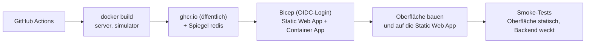

# Live-Demo auf Azure (Static Web App + Container App, Scale-to-zero)

Die öffentliche Demo besteht aus zwei Teilen (Entscheidung 2026-10-16: Oberfläche immer sofort da, Backend nur bei Bedarf):

| Teil | Adresse | Läuft | Kosten |
|---|---|---|---|
| **Oberfläche** (Azure Static Web Apps, Free) | **https://opc.vompa.dev** | immer, auch Erklärseite und Code-Feld | 0 USD |
| **Backend** (Container App: Server, Simulator, Redis) | https://api.opc.vompa.dev | nur bei Bedarf, **erst nach der Anmeldung geweckt** | ca. 0,135 USD je Laufstunde |

Zugang mit Zugangscode, Chat mit Claude (`claude-haiku-5-5`) über den eigenen MCP-Server, nur lesend, mit Tageskontingent. Der Workflow
[`deploy-azure.yml`](../.github/workflows/deploy-azure.yml) baut die Images, legt sie öffentlich auf ghcr.io ab, rollt
[`main.bicep`](main.bicep) aus, baut und veröffentlicht die Oberfläche und führt die Smoke-Tests aus
([Oberfläche](smoke-test-web.sh), ohne das Backend zu wecken; [Backend](smoke-test.sh)). Er läuft nur manuell
(Actions → *Deploy to Azure* → *Run workflow*).



## Ablauf beim Besuch

1. **Besucher öffnet https://opc.vompa.dev** (Link auf vompa.dev oder „Demo ausprobieren“): Die Static Web App liefert die Oberfläche mit
   Erklärseite und Code-Feld. **Es gibt keinen einzigen Aufruf an `api.opc.vompa.dev`**: Die Oberfläche kennt den Demo-Zugang vom Bauen
   (`VITE_DEMO_ACCESS=true`) und fragt den Server nicht danach. Das Backend schläft weiter und kostet nichts.
2. **Anmeldung** (Code oder Einladungslink `/#code=<key>`): Das ist der erste Backend-Aufruf (`POST /api/demo/login`) und weckt die Container App.
   Schläft sie noch, antwortet der Ingress mit 502/503/504 oder gar nicht; die Oberfläche wertet das als „startet noch“ (nicht als falschen
   Code), wiederholt die Anmeldung automatisch (2, 3, 5, 5, 8, dann alle 10 s, bis etwa 5 Minuten) und zeigt solange „Halle wird gestartet …“.
3. **Sofort Vorschau-Daten:** Gleich nach der Eingabe zeigt die Oberfläche die eingecheckte **Momentaufnahme** (`/snapshot/<rolle>.json`, Stand
   Do 15.10.2026 09:42, rund 52 KB, statisch von der Static Web App) mit dem Banner „Vorschau · Stand 09:42 · Live-Daten werden geladen …“.
   Die Standard-Favoriten liefern sofort ihre vorbereitete Antwort (Kennzeichnung „Vorschau“); freie Fragen warten („Wird gesendet, sobald die
   Halle bereit ist“) und gehen danach automatisch raus. Postfach übernehmen, Favoriten ändern und neue Sitzungen gehen erst mit dem Backend.
4. **Aufwachen:** Nach der Anmeldung fragt die Oberfläche `/api/health` mit wachsendem Abstand (1, 2, 3, 5, 5, 8, dann alle 10 s, höchstens
   5 Minuten; typisch ist das Backend nach etwa 40 s bereit). Antwortet es, lädt sie alle Bereiche live, ersetzt die Vorschau, startet den
   Live-Strom (SSE) und sendet die wartende Frage. Läuft die Frist ab, bleibt die Vorschau stehen und das Banner bietet „Erneut versuchen“.
5. **Wiederkehrer:** Die Oberfläche merkt sich lokal nur „angemeldet bis `<Zeitpunkt>`“ (aus der Login-Antwort, nicht geheim; weder Code noch Token).
   Gilt der Hinweis noch, weckt sie das Backend beim Öffnen gleich (ohne Erklärseite) und zeigt bis dahin die **zuletzt gesehenen Live-Daten**
   („Stand 09:47 · wird aktualisiert“, aus IndexedDB). Antwortet der Server mit 401, wird der Hinweis gelöscht und die Erklärseite erscheint.
6. **Einschlafen:** Eine Stunde nach der letzten Anfrage (`cooldownPeriod` 3600 s) skaliert die App auf null. Ein offener Tab hält sie nicht
   wach (der Live-Strom endet nach 15 Minuten ohne Aktion). Bricht der Strom ab, prüft die Oberfläche `/api/health` und weckt das Backend bei Bedarf neu.

**Cookie und CORS:** `opc.vompa.dev` und `api.opc.vompa.dev` sind verschiedene Herkünfte, aber dieselbe *Site* (`vompa.dev`). Das Sitzungs-Cookie
bleibt deshalb `Secure; HttpOnly; SameSite=Strict` und wird bei `fetch(..., { credentials: 'include' })` mitgesendet; für „strict“ zählt die Site, nicht
die Herkunft. Der Server erlaubt per `Cors:AllowedOrigins` nur die Herkunft der Oberfläche (mit Credentials) und liefert wegen `Web:ServeUi=false`
keine Oberfläche mehr aus.

## Aufbau

**Static Web App** `opc-agent-web` (Free): Oberfläche (Vue-Build) und `public/snapshot/*.json`; Sicherheitsköpfe, CSP (`connect-src` auf die API-Adresse) und SPA-Fallback stehen in [`staticwebapp.config.json`](../src/OPCAgentSample.Web/public/staticwebapp.config.json) (der Workflow setzt die API-Adresse beim Ausrollen ein).

**Container App** `opc-agent` (API-Version 2025-01-01, erst ab ihr kennt der Scale-Block `cooldownPeriod`) (`opc-agent`) mit drei Containern. Sie teilen sich Netzwerk (`localhost`) und Lebenszyklus; von außen
erreichbar ist nur der Server (Port 8080 hinter dem TLS-Ingress).

| Container | Image | Ressourcen | Aufgabe |
|---|---|---|---|
| `server` | `opcagentsample-server` | 0,5 vCPU, 1 GiB | API, SSE, MCP `/mcp`, Claude, Login, Report-Daten `/api/reports/summary` (`Web:ServeUi=false`: keine Oberfläche) |
| `simulator` | `opcagentsample-simulator` | 0,5 vCPU, 1 GiB | OPC-UA-Server der Halle (`opc.tcp://localhost:4840`) |
| `redis` | Spiegel von `redis:7-alpine` | 0,25 vCPU, 0,5 GiB | einziger Speicher, flüchtig: `--maxmemory 300mb --maxmemory-policy noeviction`, ohne Persistenz (`--save "" --appendonly no`) |

Zusammen sind das 1,25 vCPU und 2,5 GiB. Redis ist der einzige Speicher (Datenhaltung: [Spezifikation, Abschnitt 15](../docs/spec.md#15-datenhaltung-redis)); die Richtlinie `noeviction` verhindert, dass Redis stillschweigend Daten verdrängt.

**Flüchtig und reproduzierbar:** Alle Daten entstehen bei jedem Start neu aus dem Seed (Stammdaten) und der Historie des
Simulators (fester Seed, Demo-Uhr Do 15.10.2026 09:42). Nach einem Kaltstart beginnt die Demo also immer am selben
Punkt. Verlauf, Favoriten, Kontingentzähler und Login-Drossel gehen dabei verloren.

**Reports:** Der Menüpunkt „Reports“ ist eine eigene Seite der Weboberfläche. Der Server rechnet die Zahlen aus
den Nutzungszählern in Redis (`usage:*`) und seinen Zuständen (`GET /api/reports/summary`, nur mit Demo-Sitzung, ohne Frage-
und Antworttexte). Server und Simulator exportieren keine
Telemetrie (der OTLP-Export ist standardmäßig aus, `Observability__OtlpEnabled=true` schaltet ihn ein).

## Kosten

Die App läuft in **Sweden Central**: Ein Abo erlaubt je Region nur eine Container-Apps-Umgebung, und Germany West Central belegt bereits demo.vompa.dev (Fehler `MaxNumberOfRegionalEnvironmentsInSubExceeded`). Sweden Central, North Europe und Germany West Central kosten gleich viel, West Europe rund 40 % mehr.

Preise: Azure Retail Prices API, Region Germany West Central (gleich Sweden Central), Listenpreise in USD, Stand 2026-10-15.

| Posten | Preis |
|---|---|
| Container Apps, vCPU aktiv | 0,000024 USD je vCPU-Sekunde |
| Container Apps, Speicher | 0,000003 USD je GiB-Sekunde |
| Freikontingent je Subscription und Monat | 180.000 vCPU-s, 360.000 GiB-s, 2 Mio. Anfragen (geteilt mit anderen Apps im Abo) |
| Log Analytics | erste 5 GB im Monat frei, danach 2,99 USD je GB; Tageslimit 0,2 GB |
| ghcr.io (öffentliche Pakete) | 0 USD |

Die Oberfläche (Static Web Apps Free) kostet nichts. Das Backend belegt im Betrieb 1,25 vCPU und 2,5 GiB
(1,25 × 3600 × 0,000024 + 2,5 × 3600 × 0,000003 = 0,108 + 0,027 = **0,135 USD je Laufstunde**). Simulator und Collector
arbeiten laufend, deshalb gilt der Aktiv-Tarif. Ohne Anfrage skaliert die App erst nach `cooldownPeriod` = 3600 s auf null; jeder Besuch
kostet daher Kaltstart (ca. 1 min) + Nutzung (ca. 10 min) + Nachlauf (60 min) ≈ **1,2 Laufstunden ≈ 0,16 USD**, wenn die Besuche
nicht zusammenfallen (Worst Case; Besuche innerhalb einer Stunde teilen sich den Lauf).

| Besuche im Monat (je mit Anmeldung) | Laufzeit (Worst Case) | Kosten (ohne Freikontingent) |
|---|---|---|
| 2 | ca. 2,4 h | ca. 0,32 USD |
| 10 | ca. 12 h | ca. 1,62 USD |
| 30 | ca. 36 h | ca. 4,86 USD |
| Uptime-Prüfung Backend, wöchentlich (ca. 4,3 × 1,1 h) | ca. 4,7 h | ca. 0,64 USD |
| Aktion „Demo aufwecken“ (2 h + 1 h Nachlauf) | 3 h | ca. 0,41 USD je Nutzung |
| Wach-Zeitfenster täglich 8 bis 18 Uhr (`AWAKE_WINDOW=true`, nicht mehr Standard) | ca. 300 h | ca. 41 USD |
| zum Vergleich: immer an (`minReplicas = 1`, 730 h) | 730 h | ca. 99 USD |

Das Freikontingent der Subscription (180.000 vCPU-s, 360.000 GiB-s je Monat, geteilt mit anderen Apps) deckt rund 40 Laufstunden dieser App
und ist in den Zahlen nicht abgezogen. Die tägliche Uptime-Prüfung der Oberfläche kostet nichts, sie weckt das Backend nicht.

Verworfene Variante (Entscheidung 2026-10-15): eine kleine VM B2als v2 mit docker compose (≈ 38 USD im Monat, aber Pflege von Betriebssystem und SSH).

**Kostenbremsen:** Scale-to-zero mit Wecken erst nach der Anmeldung (der Link auf vompa.dev und „Demo ausprobieren“ kosten nichts); ein offener Browser-Tab hält die App nicht wach (der Live-Stream endet nach
15 Minuten ohne Aktion und wenn der Tab verborgen ist); Claude-Kontingent je Sitzung und Tag; Ausgabenlimit in der
Anthropic-Konsole; Azure-Budget mit Warnmails.

## Kaltstart

Der erste Aufruf nach dem Leerlauf startet alle Container: Images holen,
Redis starten, Stammdaten aus dem Seed einspielen und die Historie per HistoryRead nachladen und verdichten. Gemessen im lokalen Nachbau (ohne Image-Abruf): `/api/health` nach 3,5 s, Historie vollständig nach 18,4 s; in Azure mit weniger CPU und Image-Abruf entsprechend länger (typisch etwa 40 s, im schlechtesten Fall Minuten).
Der Ingress hält die Anfrage kurz, antwortet sonst mit 502/503/504; die Oberfläche überbrückt das mit der Vorschau (siehe [Ablauf beim Besuch](#ablauf-beim-besuch)), und solange die Historie noch lädt, zeigt sie einen Hinweis.

## Einmalige Einrichtung

Platzhalter in `<…>` ersetzen. Nichts davon kommt ins Repository.

```bash
az login
az group create --name rg-opc-agent --location germanywestcentral
az provider register --namespace Microsoft.App
az provider register --namespace Microsoft.OperationalInsights

# App-Registrierung für GitHub Actions (OIDC, ohne Client-Secret)
az ad app create --display-name opc-agent-sample-deploy
az ad sp create --id <app-id>
az ad app federated-credential create --id <app-id> --parameters '{
  "name": "github-azure-env",
  "issuer": "https://token.actions.githubusercontent.com",
  "subject": "repo:vompa/OPCAgentSample:environment:azure",
  "audiences": ["api://AzureADTokenExchange"]
}'

# Rechte nur auf die Resource Group (die Bicep-Datei legt keine Rollenzuweisungen an, Contributor genügt)
az role assignment create --assignee <app-id> --role Contributor \
  --scope /subscriptions/<subscription-id>/resourceGroups/rg-opc-agent
```

Meldet die Anmeldung `AADSTS700213 No matching federated identity record`, steht der erwartete Betreff (mit
unveränderlichen IDs) in der Fehlermeldung. Dann ein zweites Credential mit genau diesem Betreff anlegen.

Zugangscode und Schlüssel erzeugen (lokal, nicht speichern außer im Passwortmanager):

```bash
code="$(openssl rand -base64 18 | tr -d '/+=')"; echo "Zugangscode: $code"
printf %s "$code" | sha256sum | cut -d' ' -f1     # → DEMO_ACCESS_CODE_SHA256
openssl rand -base64 48                            # → DEMO_COOKIE_KEY
```

Im GitHub-Repository unter *Settings → Environments* eine Umgebung `azure` anlegen (optional mit Genehmigung) und unter
*Settings → Secrets and variables → Actions* eintragen:

| Typ | Name | Inhalt |
|---|---|---|
| Variable | `AZURE_CLIENT_ID` | App-ID der Registrierung |
| Variable | `AZURE_TENANT_ID` | Verzeichnis-ID |
| Variable | `AZURE_SUBSCRIPTION_ID` | Subscription-ID |
| Variable | `AZURE_RESOURCE_GROUP` | `rg-opc-agent` |
| Variable | `AZURE_LOCATION` | `swedencentral` (Region der App; leer = Region der Resource Group) |
| Variable | `CUSTOM_DOMAIN` | `api.opc.vompa.dev` (Domain des Backends, siehe [DNS](#dns-opcvompadev-und-apiopcvompadev)) |
| Variable | `CUSTOM_DOMAIN_CERTIFICATE` | Name des verwalteten Zertifikats (Schritt 3 der DNS-Einrichtung) |
| Variable | `WEB_CUSTOM_DOMAIN` | `opc.vompa.dev` (Domain der Oberfläche) |
| Variable | `AWAKE_WINDOW` | optional: `true` schaltet das tägliche Wach-Zeitfenster 8 bis 18 Uhr ein (Standard aus) |
| Secret | `DEMO_ACCESS_CODE_SHA256` | SHA-256 des Zugangscodes (64 Hex-Zeichen) |
| Secret | `DEMO_COOKIE_KEY` | Zufallsschlüssel, mindestens 32 Zeichen |
| Secret | `DEMO_INVITE_CODES` | optional: Einladungs-Keys als `name=sha256hex;name2=sha256hex` (nur Hashes, siehe [Einladungslinks](#einladungslinks)); leer = keine |
| Secret | `CLAUDE_API_KEY` | Anthropic-Key; vorher in der Anthropic-Konsole ein **Ausgabenlimit** setzen. Leer = nur vorbereitete Antworten |
| Secret | `SMOKE_ACCESS_CODE` | optional: der Zugangscode im Klartext; aktiviert Login, API und `/api/reports/summary` im Smoke-Test |

### Pakete auf ghcr.io

Die Images tragen das Label `org.opencontainers.image.source` dieses öffentlichen Repositorys und sind damit ebenfalls
öffentlich (beim ersten Deployment so beobachtet). Der Job `images` prüft das nach dem Hochladen ohne Anmeldung. Meldet
er ein Paket als nicht öffentlich, unter *github.com/vompa → Packages → Paket → Package settings → Change visibility*
auf *Public* stellen und den Workflow erneut starten. Azure holt die Images ohne Anmeldung.

### Abo-Grenze: eine Container-Apps-Umgebung

Ein Azure-Abo im Free Trial erlaubt nur **eine** Container-Apps-Umgebung insgesamt (Fehler
`MaxNumberOfGlobalEnvironmentsInSubExceeded`, bei mehreren Umgebungen in einer Region
`MaxNumberOfRegionalEnvironmentsInSubExceeded`). Für die eigene Umgebung dieser Demo neben demo.vompa.dev muss das Abo
auf Pay-As-You-Go umgestellt sein.

### DNS: opc.vompa.dev und api.opc.vompa.dev

Beide Zertifikate stellt Azure kostenlos aus und erneuert sie selbst. Einträge bei INWX (Zone `vompa.dev`):

| Name | Typ | Ziel | Zweck |
|---|---|---|---|
| `opc` | CNAME | `<Static-Web-App-Adresse>.azurestaticapps.net` (Ausgabe `webDefaultHost`, siehe unten) | Oberfläche |
| `api.opc` | CNAME | App-Adresse der Container App (`appFqdn`) | Backend |
| `asuid.api.opc` | TXT | `customDomainVerificationId` der Container App | Domain-Nachweis Backend |

Bestehende Einträge (`demo`, `asuid.demo`, Google-Verifizierung) bleiben unverändert. **Wichtig beim Umzug:** Der bisherige Eintrag `opc` (CNAME auf
die Container App) und `asuid.opc` müssen durch die neuen ersetzt werden; bis dahin zeigt `opc.vompa.dev` noch auf das Backend.

1. Erstes Deployment **ohne** `CUSTOM_DOMAIN`/`WEB_CUSTOM_DOMAIN` ausrollen; danach die Werte holen:

   ```bash
   az deployment group show -g rg-opc-agent -n main --query properties.outputs   # webDefaultHost, appFqdn
   az containerapp show -n opc-agent -g rg-opc-agent --query properties.customDomainVerificationId -o tsv
   ```

2. DNS-Einträge laut Tabelle anlegen (CNAME `api.opc` und TXT `asuid.api.opc`, danach CNAME `opc` auf die Static Web App).
3. Backend-Domain anhängen und Zertifikat ausstellen lassen (kann bis zu 20 Minuten dauern):

   ```bash
   az containerapp hostname add  -n opc-agent -g rg-opc-agent --hostname api.opc.vompa.dev
   az containerapp hostname bind -n opc-agent -g rg-opc-agent --hostname api.opc.vompa.dev \
     --environment opc-agent-env --validation-method CNAME
   ```

   Die Ausgabe nennt das Zertifikat (`.../managedCertificates/<zertifikatsname>`).
4. Die Variablen `CUSTOM_DOMAIN` (`api.opc.vompa.dev`), `CUSTOM_DOMAIN_CERTIFICATE` (`<zertifikatsname>`) und `WEB_CUSTOM_DOMAIN` (`opc.vompa.dev`)
   setzen und neu ausrollen. Die Static Web App validiert ihre Domain per CNAME (`cname-delegation`); der CNAME `opc` muss dafür schon stehen.
   Ohne die Variablen entfernt jedes Deployment die Domains wieder, und CORS erlaubt dann nur die Azure-Adresse der Oberfläche.

## Betrieb

- **Ausrollen:** Actions → *Deploy to Azure* → *Run workflow* (main). Der Smoke-Test wartet auf den Kaltstart.
- **Spiegel Redis:** Der Workflow spiegelt `redis:7-alpine` nur, wenn es auf ghcr.io noch fehlen (ein Deploy hängt so nicht an Docker Hub). Für Sicherheitsupdates beim Start *refresh-mirrors* anhaken.
- **Wachzeiten:** Standard ist Scale-to-zero ohne Wach-Zeitfenster; das Backend wird nach der Anmeldung geweckt. Variable `AWAKE_WINDOW` = `true` hält die App täglich 8 bis 18 Uhr Wiener Zeit wach (KEDA-Cron, Parameter `awakeStart`/`awakeEnd`/`awakeTimeZone`, ca. 41 USD/Monat). `MIN_REPLICAS` = `1` hält sie immer wach (ca. 99 USD/Monat). Der Nachlauf vor dem Einschlafen ist `cooldownSeconds` (Standard 3600). Nach Änderung neu ausrollen.
- **Vor einem Termin wecken:** Actions → *Demo aufwecken* → *Run workflow* mit der Anzahl Stunden (Standard 2, höchstens 6). Der Workflow weckt das Backend per `GET /api/health` und ruft es alle 20 Minuten erneut auf, solange es wach bleiben soll. Gewählt gegenüber einer Änderung von `minReplicas`, weil es ohne Azure-Anmeldung und Schreibrechte auskommt, die ausgerollte Konfiguration nicht verstellt (ein späteres Deployment würde sie zurücksetzen) und gleich viel kostet (der Nachlauf beträgt ohnehin eine Stunde). Abbrechen des Laufs beendet das Wachhalten.
- **Verfügbarkeit:** [`uptime.yml`](../.github/workflows/uptime.yml) prüft täglich die Oberfläche (kostenlos, weckt nichts) und montags zusätzlich `https://api.opc.vompa.dev/api/health` mit Kaltstart.
  GitHub deaktiviert geplante Workflows nach 60 Tagen ohne Aktivität; dann im Actions-Tab wieder aktivieren.
- **Vorschau-Daten aktualisieren:** Ändert sich etwas, das die Oberfläche zeigt (Übersicht, Postfach, Meldungen, Favoriten, Referenzantworten), bricht der Test `SnapshotTests` ab und nennt den Befehl: `docker compose up -d redis`, dann `dotnet run --project src/OPCAgentSample.Snapshot -- src/OPCAgentSample.Web/public/snapshot` (nimmt die Szenario-Historie in ein Wegwerf-Redis auf, startet den Server in-process und ruft dessen API wie die Oberfläche) und die geänderten JSON-Dateien einchecken.
- **Logs:** Log Analytics `opc-agent-logs`, Tabelle `ContainerAppConsoleLogs_CL` (Spalte `ContainerName_s`). Metriken
  und Traces werden in Azure nicht exportiert; Nutzung und Betrieb zeigt die Report-Seite der Weboberfläche (ihre Zahlen stammen
  aus dem flüchtigen Redis und beginnen mit jedem Kaltstart neu).
- **Zugangscode wechseln:** neuen Code erzeugen, `DEMO_ACCESS_CODE_SHA256` ersetzen, neu ausrollen.
- **Einladung vergeben oder sperren:** siehe [Einladungslinks](#einladungslinks).
- **Claude abschalten:** Secret `CLAUDE_API_KEY` leeren und neu ausrollen; die Demo zeigt dann nur vorbereitete Antworten.
- **Immer an statt Scale-to-zero:** Parameter `minReplicas=1` (rund 99 USD im Monat).
- **Lokal wie in Azure testen (getrennt):** `CORS_ALLOWED_ORIGIN=http://localhost:4173 WEB_SERVE_UI=false` zum `docker compose … up` setzen, die Oberfläche mit `VITE_API_BASE=http://localhost:8080 VITE_DEMO_ACCESS=true WEB_OUT_DIR=dist npm run build` und `npx vite preview --port 4173 --outDir dist` bereitstellen.
- **Aufräumen:** `az group delete --name rg-opc-agent` entfernt alle Kosten. Die DNS-Einträge bei INWX danach von Hand
  entfernen.

## Einladungslinks

Neben dem gemeinsamen Zugangscode lassen sich **benannte Einladungs-Keys** vergeben, jeder nur für eine Person. Der Link
`https://opc.vompa.dev/#code=<key>` meldet ohne Eingabe an (und weckt das Backend). Der Zugangscode bleibt unverändert gültig.

1. **Key erzeugen** (je Person einer) und **Hash bilden**:

   ```bash
   key="$(openssl rand -base64 18 | tr -d '/+=')"; echo "Link: https://opc.vompa.dev/#code=$key"
   printf %s "$key" | sha256sum | cut -d' ' -f1     # → Hash für DEMO_INVITE_CODES
   ```

2. **Secret `DEMO_INVITE_CODES`** (im Environment `azure`) setzen als ein String `name=hash;name2=hash`. Der Name ist
   1 bis 40 Zeichen aus `a-z`, `0-9`, `-`, eindeutig; er steht im Protokoll, nie der Key. Beispiel:
   `anna=3c9a…;ben=b71f…` (je 64 Hex-Zeichen). Fehlerhafte Einträge verhindern den Start mit einer Meldung, die `Demo:InviteCodes` nennt.
3. **Neu ausrollen** (Workflow *Deploy to Azure*). Danach den Link nur an die jeweilige Person schicken.
4. **Sperren:** Eintrag aus dem Secret entfernen und neu ausrollen. Bestehende Sitzungen laufen bis zu ihrem Ablauf
   (`Demo:SessionHours`, 8 h) weiter; sofort beendet sie nur ein neuer `DEMO_COOKIE_KEY`, der alle Sitzungen ungültig macht.
5. **Wer hat sich angemeldet?** Im Log (`ContainerAppConsoleLogs_CL`) steht je Anmeldung `Demo-Anmeldung über Zugang „anna“`
   (bzw. `zugangscode` für den Hauptcode).

Hinweise zur Sicherheit: Das Fragment (`#…`) geht nie an den Server und steht in keinem Zugriffsprotokoll. Die Seite entfernt es beim
Öffnen sofort aus der Adresszeile und speichert den Key nicht. Er bleibt aber in der Mail oder Nachricht und im Verlauf des
Empfängers, bis diese gelöscht werden: Einladungen daher persönlich verschicken und bei Verdacht sperren. Fehlversuche zählen
für die Anmelde-Drossel wie beim Zugangscode.

## Not-Stopp bei Budgetüberschreitung

Für Pay-As-You-Go gibt es in Azure keine harte Ausgabengrenze. Ersatz: Das Monatsbudget des Abos
(`vompa-monatsbudget`, 20 USD) hat eine Benachrichtigung bei **100 % der tatsächlichen Kosten**, die die Aktionsgruppe
`opc-agent-budget-stop` auslöst. Deren Logic App `opc-agent-stop` stoppt die Container App (nur diese; andere Dienste
im Abo laufen weiter). Azure rechnet mit einigen Stunden Verzögerung ab, der Betrag kann also leicht überschritten
werden.

Einmalig ausrollen (braucht Besitzer-Rechte wegen der Rollenzuweisung, deshalb nicht im Deploy-Workflow):

```bash
az provider register -n Microsoft.Logic
az provider register -n Microsoft.Insights
az deployment group create -g rg-opc-agent --template-file infra/cost-guard.bicep
```

Dann im Budget (Portal: Kostenverwaltung → Budgets → Bearbeiten → Warnungsbedingungen) eine Bedingung „Tatsächlich,
100 %“ mit der Aktionsgruppe `opc-agent-budget-stop` anlegen.

Wieder einschalten, nachdem der Stopp gegriffen hat (z. B. im neuen Monat):

```bash
az rest --method post --url "https://management.azure.com/subscriptions/<subscription-id>/resourceGroups/rg-opc-agent/providers/Microsoft.App/containerApps/opc-agent/start?api-version=2025-01-01"
```

## Grenzen

- Flüchtige Daten (gewollt): Verlauf und Favoriten der Besucher überstehen keinen Kaltstart. Die Vorschau zeigt den Stand der Momentaufnahme (Do 15.10.2026 09:42), nicht den des Backends.
- Die Momentaufnahme liegt öffentlich auf der Static Web App (sie enthält nur die simulierten Demo-Daten, keine Geheimnisse). Wer irgendeinen Code eingibt, während das Backend schläft, sieht die Vorschau, bis der Server den Code prüfen kann; ist er falsch, kehrt die Oberfläche zur Anmeldung zurück.
- Das Tageskontingent für Claude liegt im flüchtigen Redis und beginnt nach jedem Kaltstart neu. Die harte Kostengrenze
  ist das Ausgabenlimit in der Anthropic-Konsole.
- Genau eine Replik: Redis liegt in der App; mehrere Repliken hätten eigene Daten.
- Redis ist der einzige Speicher. Wird es geleert oder startet neu, antwortet `/api/health` mit 503, bis der Server die Stammdaten aus dem Seed neu eingespielt und die Historie neu aufgenommen hat („Neuaufbau aus dem Seed“); Verlauf und Favoriten gehen dabei verloren.
- Der Smoke-Test prüft Erreichbarkeit und Zugriffsschutz, nicht die fachlichen Antworten (die prüfen die Tests).
- Web-Push (VAPID) für dringende Postfach-Fälle ist im Server noch nicht umgesetzt.
